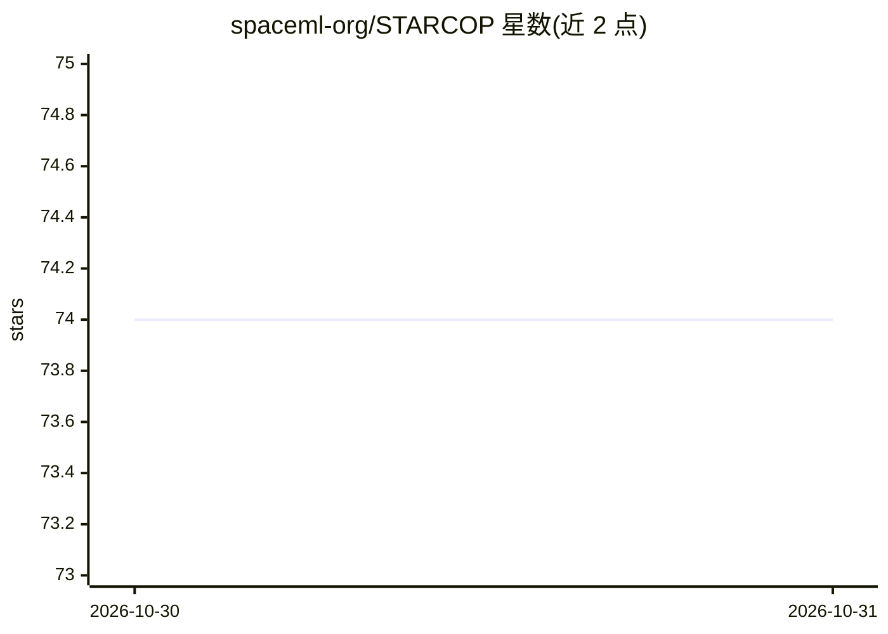

# spaceml-org/STARCOP

⭐ 74 · Jupyter Notebook · GPL-3.0 · 推送 2026-10-29 · [GitHub](https://github.com/spaceml-org/STARCOP) · 组织维护

**遥感甲烷羽流分割模型：高光谱/多光谱数据语义分割检测甲烷泄漏**

STARCOP 是用于高光谱（AVIRIS-NG、EMIT）与多光谱（WorldView-3 模拟）遥感数据中甲烷羽流语义分割的轻量级模型与数据集发布。以经典甲烷增强产品（如 mag1c）作为输入特征，提供传感器无关的机器学习架构；论文报告在 AVIRIS-NG 上 F1 超过匹配滤波基线 25%，并在 EMIT 数据上展示零样本泛化。完整标注训练/评估数据集托管于 Zenodo，预训练模型存于 Hugging Face。安装通过 conda 环境加 pip 从 GitHub 安装，训练需先下载数据集。

## 筛选速览

| 维度 | 判定 | 备注 |
|---|---|---|
| AI 角色 | `ai-native` | 本体是模型或模型工具 |
| 许可风险 | `viral` | GPL-3.0 |
| 部署形态 | `library` | 以包/库形式分发 |
| 模型依赖 | — | README 未给出锁定关系 |
| 硬件要求 | — | 无带数字的原话,不猜 |
| 安装摩擦 | `low` | 无编译、无系统依赖或容器化 |
| 成熟度 | — | 结构信号不足 |

## 能力要点

- 甲烷羽流语义分割模型（HyperSTARCOP），输入为经典甲烷增强产品
- 公开人工精修标注的机器学习就绪数据集（AVIRIS-NG 高光谱 + WorldView-3 模拟多光谱）
- 预训练模型托管于 Hugging Face，提供 AVIRIS 与 EMIT 推理 Colab demo
- 提供完整训练脚本与最小训练示例

## 适用场景

- 从高光谱/多光谱卫星影像中检测甲烷泄漏羽流
- 复现论文中的甲烷羽流分割训练流程
- 跨传感器（AVIRIS-NG/EMIT）模型基准评测

## 场景标签

`目标检测` · 领域:感知与多模态

## 证据(README 行号)

> L6:  We introduce the STARCOP system, a lightweight model for methane plume detection in hyperspectral (AVIRIS-NG and EM
> L19: Methane is the second most important greenhouse gas contributor to climate change; at the same time its reduction h

## 星数曲线

2026-10-30 74 → 2026-10-31 74（+0）

---
*卡片 v1 · prompt 1.4 · 生成 2026-10-30 · 置信度 high · 依据 README sha `49954a21a50a` · [字段定义](../../DATASET.md)*
