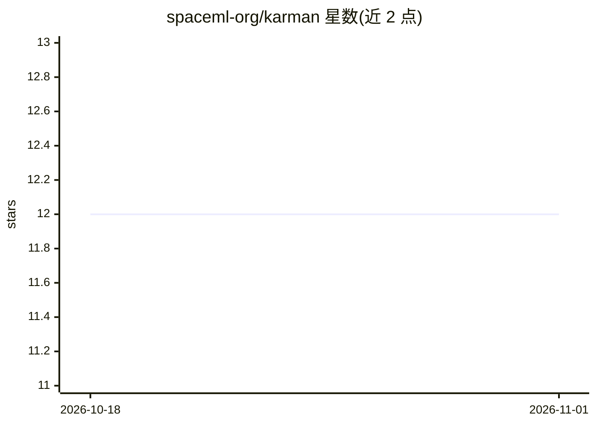

# spaceml-org/karman

⭐ 12 · Python · Apache-2.0 · 推送 2026-01-19 · [GitHub](https://github.com/spaceml-org/karman) · [官网](https://spaceml-org.github.io/karman/) · 组织维护

**机器学习热层密度现报/预报建模与基准测试 Python 包**

NASA 太阳物理部门与 Trillium Technologies 合作的 Python 包，面向热层大气密度建模：提供预训练模型，从太阳与地磁数据（F10.7、Dst、SOHO/GOES EUV 辐照等）现报与预报热层密度变化，训练数据来自五颗卫星任务（CHAMP、GOCE、GRACE、SWARM-A/B）的 POD 反演密度。同时提供共享框架，支持数据摄取、模型设计训练，以及在不同地磁暴条件、高度与时间下比较 ML 与经验模型（如 NRLMSISE-00 相关输入）。预训练预报模型在 SWxTREC 平台可视化展示。

## 筛选速览

| 维度 | 判定 | 备注 |
|---|---|---|
| AI 角色 | `ai-native` | 本体是模型或模型工具 |
| 许可风险 | `permissive` | Apache-2.0 |
| 部署形态 | `None` |  |
| 模型依赖 | — | README 未给出锁定关系 |
| 硬件要求 | — | 无带数字的原话,不猜 |
| 安装摩擦 | `low` | 无编译、无系统依赖或容器化 |
| 成熟度 | — | 结构信号不足 |

## 能力要点

- 预训练模型基于太阳与地磁数据现报/预报热层密度
- 支持多源数据摄取：太阳指数、地磁指数、SOHO/GOES EUV 辐照、POD 密度数据
- 提供 ML 与经验模型在不同地磁暴条件下的比较框架
- 附各数据源下载与预处理的教程和脚本

## 适用场景

- 用预训练模型现报/预报热层密度变化
- 设计、训练并基准测试自定义热层密度模型
- 接入多源太阳/地磁/POD 数据进行机器学习建模

## 场景标签

`模型评测` `模型训练` · 领域:评测与运维

## 证据(README 行号)

> L17: Karman is a machine learning (ML) Python package for thermospheric density modelling. It was developed as a collabo
> L25: * Release of ML models to nowcast & forecast thermospheric density changes from solar and geomagnetic data, trained

## 星数曲线

2026-10-18 12 → 2026-11-01 12（+0）

---
*卡片 v1 · prompt 1.4 · 生成 2026-11-01 · 置信度 high · 依据 README sha `9f57f264dc3d` · [字段定义](../../DATASET.md)*
