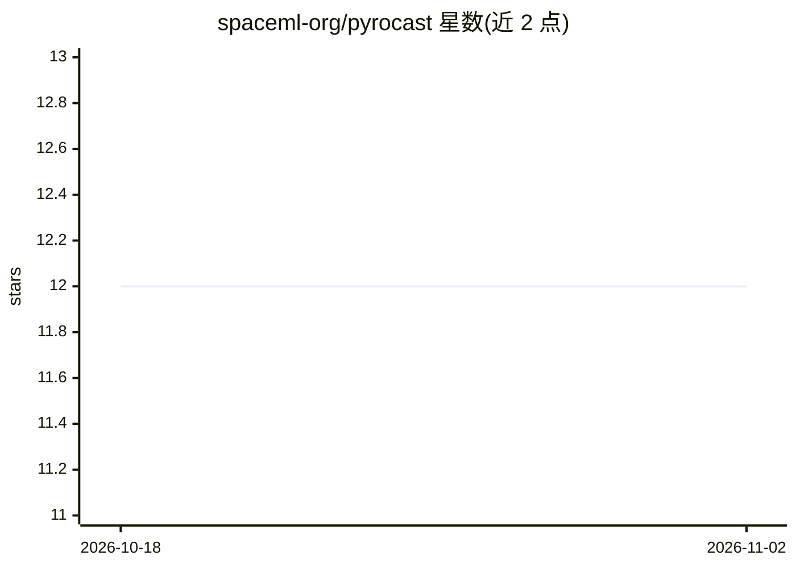

# spaceml-org/pyrocast

⭐ 12 · Jupyter Notebook · 推送 2026-10-18 · [GitHub](https://github.com/spaceml-org/pyrocast) · 组织维护

**预测极端野火的端到端机器学习流水线（火积雨云预报）**

面向野火研究的机器学习流水线，围绕火积雨云（PyroCb）这一极端野火前兆，提供数据下载与格式化、NRL 算法标注 PyCb、模型预报、以及 ICP 因果驱动因素分析四个模块。数据以 Zarr 格式存储于 Google Cloud Storage，包含静止卫星多通道影像（Himawari-8/GOES-16/17）、气象与燃料 19 通道数据，每个事件为 200x200 空间立方体。需联系作者获取数据访问权限；README 声明代码尚不完整，作者业余维护。

## 筛选速览

| 维度 | 判定 | 备注 |
|---|---|---|
| AI 角色 | `ai-native` | 本体是模型或模型工具 |
| 许可风险 | `none` | — |
| 部署形态 | `None` |  |
| 模型依赖 | — | README 未给出锁定关系 |
| 硬件要求 | — | 无带数字的原话,不猜 |
| 安装摩擦 | `low` | 无编译、无系统依赖或容器化 |
| 成熟度 | `idea` | |

## 能力要点

- 数据加载、NRL 算法标注、预报模型、ICP 因果分析四模块
- Zarr 格式组织卫星影像、气象与燃料数据（Nx200x200 立方体）
- 支持 Himawari-8 与 GOES-16/17 两种静止卫星通道数据

## 适用场景

- 我研究极端野火，需要预报火积雨云出现
- 分析火积雨云的气象与燃料因果驱动因素
- 处理并标注野火事件的卫星影像数据集

## 场景标签

`目标检测` · 领域:感知与多模态

## 证据(README 行号)

> L7: Pyrocast is a end-to-end machine learning pipeline for the prediction of extreme and dangerous wildfires. More speci
> L11: * `models` to forecast the pyrocumolonimbus clouds

## 星数曲线

2026-10-18 12 → 2026-11-02 12（+0）

---
*卡片 v1 · prompt 1.4 · 生成 2026-11-01 · 置信度 high · 依据 README sha `ccfc759c35cc` · [字段定义](../../DATASET.md)*
