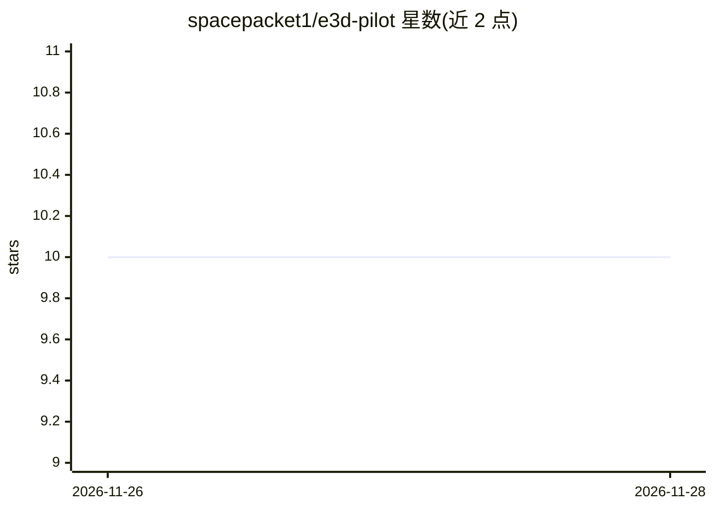

# spacepacket1/e3d-pilot

⭐ 10 · Shell · MIT · 推送 2026-11-27 · [GitHub](https://github.com/spacepacket1/e3d-pilot) · 个人维护

**多模型独立作答、互评收敛并留痕的 AI 求解工具**

e3d-pilot 让多个已配置的 AI 模型回答同一问题：各模型独立作答、跨轮互相批评、收敛为带共识等级与具名分歧的综合答案，再交由人工决策后执行，全程写入 append-only 账本以追溯从想法到结果的出处。核心组件 bin/e3d-debate 可独立运行，无需仓库或流水线；e3d-mcp 是零依赖的 MCP 服务器，发布于 npm，可在 GitHub Copilot、Claude Code、Cursor 中调用。限制：至少需要两个已登录的模型 CLI，辩论消耗用户自有模型额度，快速模式数秒、深度模式数分钟。

## 筛选速览

| 维度 | 判定 | 备注 |
|---|---|---|
| AI 角色 | `ai-native` | 本体是模型或模型工具 |
| 许可风险 | `permissive` | MIT |
| 部署形态 | `self-host` | docker 或自建部署 |
| 模型依赖 | — | README 未给出锁定关系 |
| 硬件要求 | — | 无带数字的原话,不猜 |
| 安装摩擦 | `low` | 无编译、无系统依赖或容器化 |
| 成熟度 | `idea` | |

## 能力要点

- 多模型独立作答、互评与早停收敛，输出共识等级（full/majority/split）与具名分歧
- 零依赖 MCP 服务器，一条 npx 命令接入 Copilot/Claude Code/Cursor
- append-only 账本记录从想法到结果的完整出处链
- API 供应商自带 web 搜索可开关，带每调用/每日配额与域名白黑名单

## 适用场景

- 在选定技术方案（如 SQLite 还是 flat JSON）前让多个模型给出第二意见
- 让 AI 编码助手在有争议的设计决策上自动发起多模型辩论
- 追溯一个已执行变更的来源：哪些模型与人员影响了它、产出了什么

## 场景标签

`多智能体` · 领域:Agent 开发

## 证据(README 行号)

> L3: **Multi-model AI problem solving: independent answers → critique → convergence → human decision → execution → review
> L5: e3d-debate: independent AI models answer a question, critique each other across rounds, converge on a synthesis with
> L9: It starts simply. Ask several configured models (Claude, Codex, Grok, Devin, or others you wire in) the same questio

## 星数曲线

2026-11-26 10 → 2026-11-28 10（+0）

---
*卡片 v1 · prompt 1.4 · 生成 2026-11-26 · 置信度 mid · 依据 README sha `0b83e90ca81b` · [字段定义](../../DATASET.md)*
