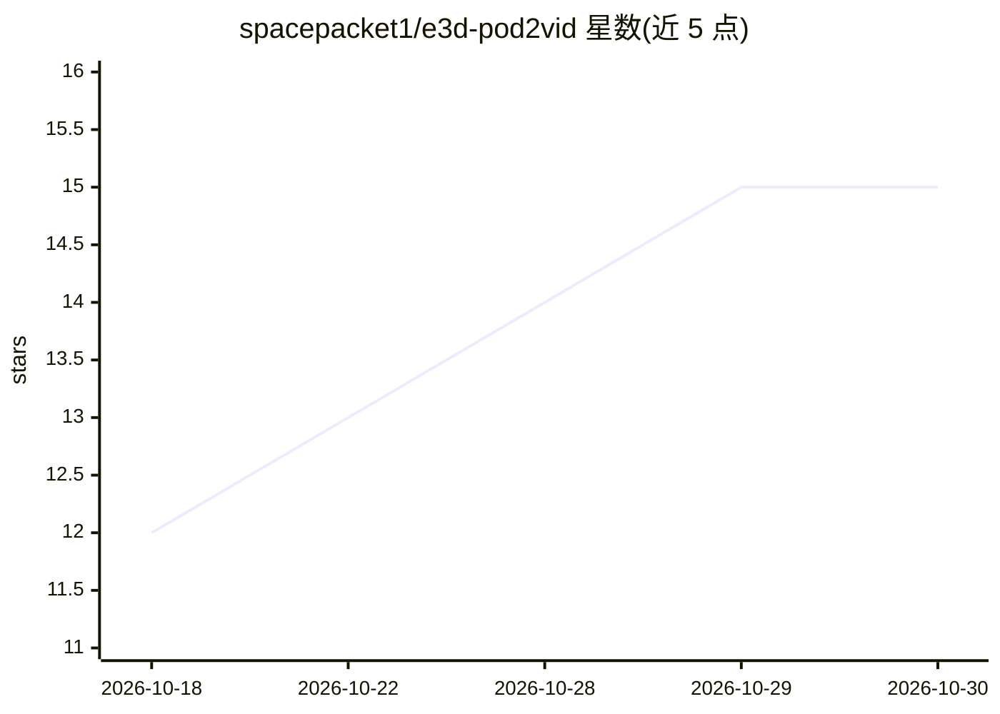

# spacepacket1/e3d-pod2vid

⭐ 15 · Python · MIT · 推送 2026-10-17 · [GitHub](https://github.com/spacepacket1/e3d-pod2vid) · 个人维护

**将播客音频自动转为成片并发布 YouTube/社媒的流水线**

面向内容创作者与自动化运维的 Python+Node 工具集：单条命令将已分角色的音频（NotebookLM、访谈等）经 AssemblyAI 说话人分离、GPT-4o-mini 逐句生成 Pexels 检索词匹配 B-roll、纯 Pillow 渲染烧录字幕，拼接为 MP4 与 SRT；可选 OpenAI TTS 或 ElevenLabs 替换原声、Higgsfield 生成 B-roll；附 YouTube 上传、缩略图生成、多平台（Discord/Telegram/X/LinkedIn 等）一键发布，以及基于 maps.e3d.ai 信号自动生成 YouTube Short 的 PM2 定时任务和托管任务包装器。各环节结果以 JSON/文件缓存加速重跑。

## 筛选速览

| 维度 | 判定 | 备注 |
|---|---|---|
| AI 角色 | `ai-native` | 本体是模型或模型工具 |
| 许可风险 | `permissive` | MIT |
| 部署形态 | `None` |  |
| 模型依赖 | — | README 未给出锁定关系 |
| 硬件要求 | — | 无带数字的原话,不猜 |
| 安装摩擦 | `medium` | 含编译或系统依赖之一 |
| 成熟度 | — | 结构信号不足 |

## 能力要点

- GPT-4o-mini 逐话语语义匹配 Pexels B-roll 并按查询缓存
- 纯 Pillow 字幕烧录，无需 ffmpeg libass
- 可选 OpenAI TTS / ElevenLabs 语音替换与 Higgsfield B-roll 生成
- YouTube 上传 + 5 个社媒平台一键发布，附带每日信号自动成片的定时方案

## 适用场景

- 把访谈或 NotebookLM 播客一键转成带字幕和 B-roll 的 YouTube 视频
- 用自定义 TTS 声音替换原始播客人声再成片
- 定时抓取信号数据自动生成并发布 YouTube Short 到各社媒

## 场景标签

`语音合成` `语音识别` `工作流自动化` · 领域:效率与自动化

## 证据(README 行号)

> L3: **AI-powered podcast-to-video pipeline.** Converts a diarized audio file (NotebookLM, podcast, interview) into a You
> L30: 2. Asks GPT-4o-mini for a specific Pexels search query per utterance
> L42: # Synthesize with OpenAI TTS voices

## 星数曲线

2026-10-18 12 → 2026-10-30 15（+3）

---
*卡片 v1 · prompt 1.4 · 生成 2026-10-30 · 置信度 high · 依据 README sha `4f66a9f778b2` · [字段定义](../../DATASET.md)*
