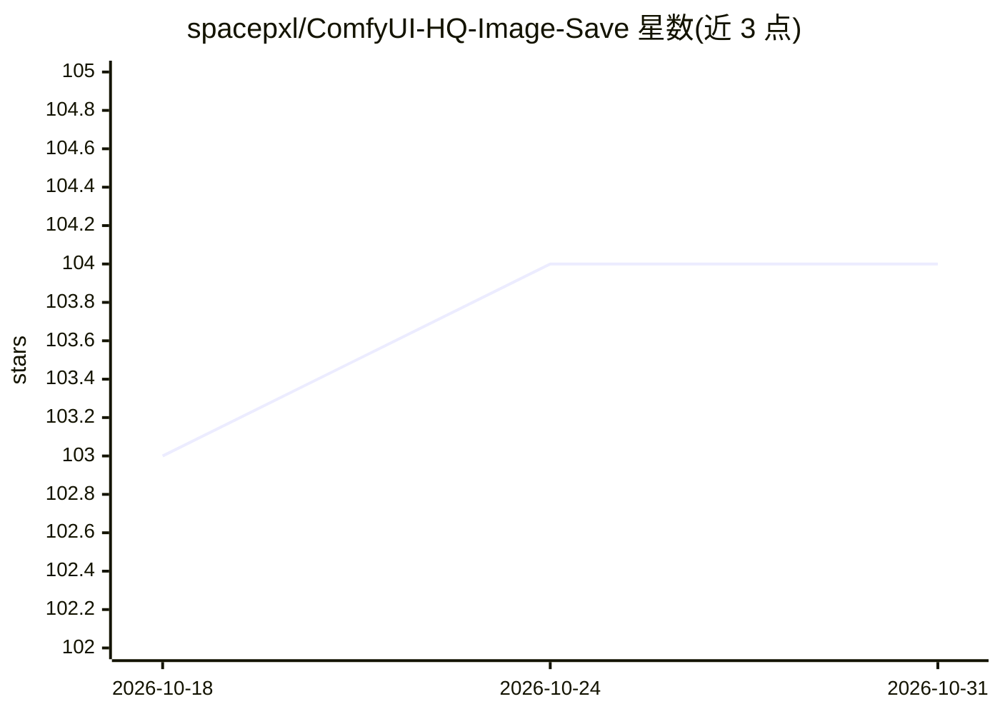

# spacepxl/ComfyUI-HQ-Image-Save

⭐ 104 · Python · MIT · 推送 2026-03-09 · [GitHub](https://github.com/spacepxl/ComfyUI-HQ-Image-Save) · 个人维护

**ComfyUI 自定义节点：以 32bit EXR 存取图像与 latents**

ComfyUI 功能节点集，提供图像与 latent 的 EXR 高精度读写节点：Load EXR 支持单文件或文件夹批量（带上限/跳过/取样控制），Save EXR 输出 RGB/RGBA 32bpc 并支持批次、相对/绝对路径、版本与帧号格式化及覆盖保护；另可保存 4 通道 latent 为 RGBA 32bpc EXR、帧序列保存并可附带 workflow JSON。README 提示使用 --fp32-vae 参数提升解码精度，并说明 TIFF 节点已过时、无加载 TIFF 节点。

## 筛选速览

| 维度 | 判定 | 备注 |
|---|---|---|
| AI 角色 | `ai-ecosystem` | LLM/agent 周边工具 |
| 许可风险 | `permissive` | MIT |
| 部署形态 | `None` |  |
| 模型依赖 | — | README 未给出锁定关系 |
| 硬件要求 | — | 无带数字的原话,不猜 |
| 安装摩擦 | `low` | 无编译、无系统依赖或容器化 |
| 成熟度 | — | 结构信号不足 |

## 能力要点

- Load/Save EXR 节点支持单文件、文件夹批量与帧序列（%04d 格式化）
- Save EXR 支持 32bpc RGB/RGBA、批次、版本与帧号路径格式化及覆盖保护
- 4 通道 latent 可存为 RGBA 32bpc EXR，并给出近似 RGB 的换算公式
- 帧序列保存时可附带 workflow GUI JSON / API JSON

## 适用场景

- 在 ComfyUI 工作流中以全浮点精度保存生成图像，避免 PNG 8bit 量化
- 保存/回读 latents 以便后续工作流复用
- 按帧序列导出动画图像并保留 workflow 信息

## 场景标签

`图像生成` · 领域:内容生成

## 证据(README 行号)

> L1: # ComfyUI-HQ-Image-Save
> L14: Save and load images and latents as 32bit EXRs

## 星数曲线

2026-10-18 103 → 2026-10-31 104（+1）

---
*卡片 v1 · prompt 1.4 · 生成 2026-10-23 · 置信度 high · 依据 README sha `bb042abbe653` · [字段定义](../../DATASET.md)*
