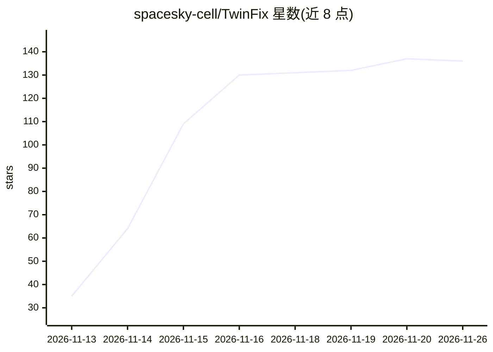

# spacesky-cell/TwinFix

⭐ 136 · Python · Apache-2.0 · 推送 2026-11-20 · [GitHub](https://github.com/spacesky-cell/TwinFix) · 个人维护 · 中文 README

**在一次性孪生环境中自动诊断、复现并修复线上故障的 AI Agent**

面向线上故障的自动化修复系统：从告警、错误日志、Issue 或手动提交接入，由 4 个 LLM Agent（诊断/复现/修复/验证）加 1 个确定性 Reporter 完成“分诊→诊断→复现→修复→独立验证→人工批准→合并”闭环。修复在从目标分支构建的一次性孪生环境（Docker Compose/Kubernetes）中执行，验证使用 Agent 不可见的隐藏测试。LangGraph 状态机编排，状态写入 PostgreSQL checkpoint 支持断点恢复。支持 Java/Python/Go/TS/C# 五种语言，通过 OpenAI 兼容端点接入 LLM；提供演示模式（stub Agent，无需 LLM Key）、40 个故障注入用例的 Arena 基准测试套件与 React 控制台。当前为 v0.1 alpha，生产使用前需自行验证适配器并配置鉴权。

## 筛选速览

| 维度 | 判定 | 备注 |
|---|---|---|
| AI 角色 | `ai-native` | 本体是模型或模型工具 |
| 许可风险 | `permissive` | Apache-2.0 |
| 部署形态 | `self-host` | docker 或自建部署 |
| 模型依赖 | — | README 未给出锁定关系 |
| 硬件要求 | — | 无带数字的原话,不猜 |
| 安装摩擦 | `low` | 无编译、无系统依赖或容器化 |
| 成熟度 | `idea` | |

## 能力要点

- 4 个 LLM Agent + 确定性 Reporter 的端到端故障修复闭环
- 修复在一次性孪生环境中执行，由独立流程用隐藏测试验证
- 工具统一网关按风险分级授权，只允许推送 fix/twinfix-* 分支，合并需人工批准
- 自带 Arena 基准套件：5 个示例服务、40 个故障注入用例

## 适用场景

- 线上告警或错误日志进来后自动完成根因诊断与修复 PR
- 值班工程师在控制台审查 AI 产出的诊断报告、diff 并批准合并
- 用内置 Arena 用例评测自动修复的修复率、误修率与根因命中率

## 场景标签

`编码 Agent` `模型评测` · 领域:编码与开发

## 证据(README 行号)

> L3:  在一次性隔离环境中自动诊断、复现并修复故障的 AI Agent
> L28: TwinFix 是一个面向线上故障的 AI Agent。它从告警、错误日志、Issue 或手动提交接入，自动完成分诊（triage）、诊断、复现、修复、验证与报告，最终把一个已经在真实运行环境中验证过的修复交给人工评审和合并。
> L50: |端到端闭环|4 个 LLM Agent（诊断 / 复现 / 修复 / 验证）+ 1 个确定性 Reporter；Fixer 与 Verifier 自动迭代，默认最多 3 轮|

## 星数曲线

2026-11-13 35 → 2026-11-26 136（+101）

---
*卡片 v1 · prompt 1.4 · 生成 2026-11-17 · 置信度 high · 依据 README sha `c826de4e341f` · [字段定义](../../DATASET.md)*
