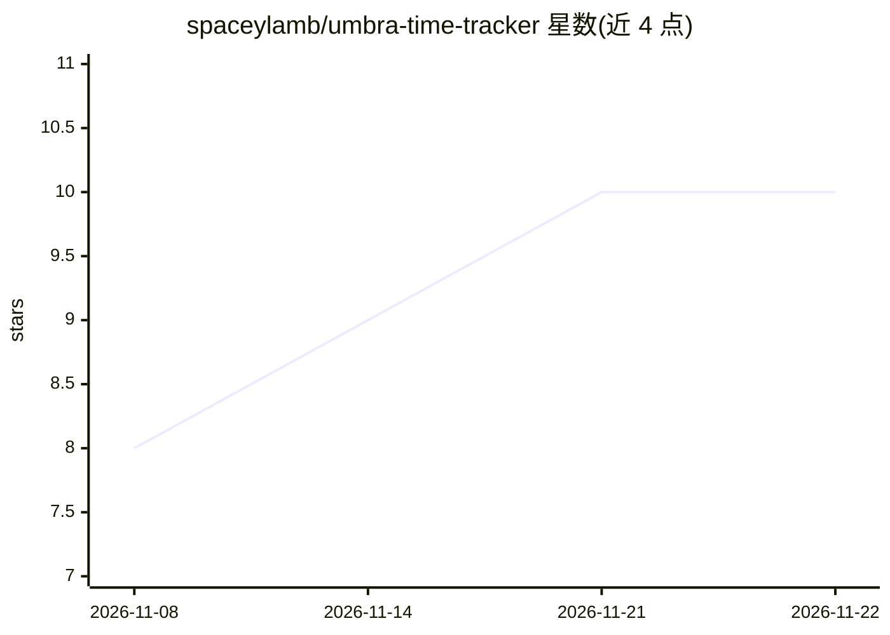

# spaceylamb/umbra-time-tracker

⭐ 10 · Python · Apache-2.0 · 推送 2026-11-06 · [GitHub](https://github.com/spaceylamb/umbra-time-tracker) · [官网](https://spaceylamb.github.io/umbra-time-tracker/) · 个人维护

**读取本地数字痕迹、用 LLM 重建全天时间线的本地优先时间追踪器**

Umbra 从 13 类内置来源（Chrome 历史、shell、git、前台应用、iPhone、WHOOP、PLAUD、位置等）采集事件到单一 SQLite 库，先离线生成 5 分钟粒度时间块，再由用户配置的模型将时间跨度重建为可审计的日历事件——每个事件可下钻到模型读取的原文、引用记录与原始证据。区分"无数据/未导入/模型沉默/解析失败"等状态。macOS 功能最全，Linux 支持部分来源，Windows 未支持。默认走 Gemini，需 API key 或自配 OpenAI 兼容端点。

## 筛选速览

| 维度 | 判定 | 备注 |
|---|---|---|
| AI 角色 | `ai-native` | 本体是模型或模型工具 |
| 许可风险 | `permissive` | Apache-2.0 |
| 部署形态 | `library` | 以包/库形式分发 |
| 模型依赖 | local-ok | 支持本地模型 |
| 硬件要求 | — | 无带数字的原话,不猜 |
| 安装摩擦 | `low` | 无编译、无系统依赖或容器化 |
| 成熟度 | — | 结构信号不足 |

## 能力要点

- 13 个内置采集来源 + 单文件 Python 插件扩展
- 增量推理：输入未变的窗口零 API 调用
- 事件级溯源审计：跨度、模型读取文本、引用记录
- 支持任意 OpenAI 兼容端点，判决按模型分存可对比

## 适用场景

- 自动生成一天的时间线，弄清时间花在了哪里
- 从录音转写中提取待办并推送到自建服务
- 在同一日期上对比不同模型的时间判定结果
- 手机上查看导出的只读时间线站点

## 场景标签

 · 领域:效率/个人数据追踪

## 证据(README 行号)

> L11: Pull your scattered digital footprints onto one timeline, and let an AI
> L23:          ├─→ LLM inference: spans → calendar events   any model you configure
> L179: Zero config uses Gemini (`GEMINI_API_KEY`); `gpt-*` and `claude-*` models

## 星数曲线

2026-11-08 8 → 2026-11-22 10（+2）

---
*卡片 v1 · prompt 1.4 · 生成 2026-11-20 · 置信度 mid · 依据 README sha `05da8413fc54` · [字段定义](../../DATASET.md)*
