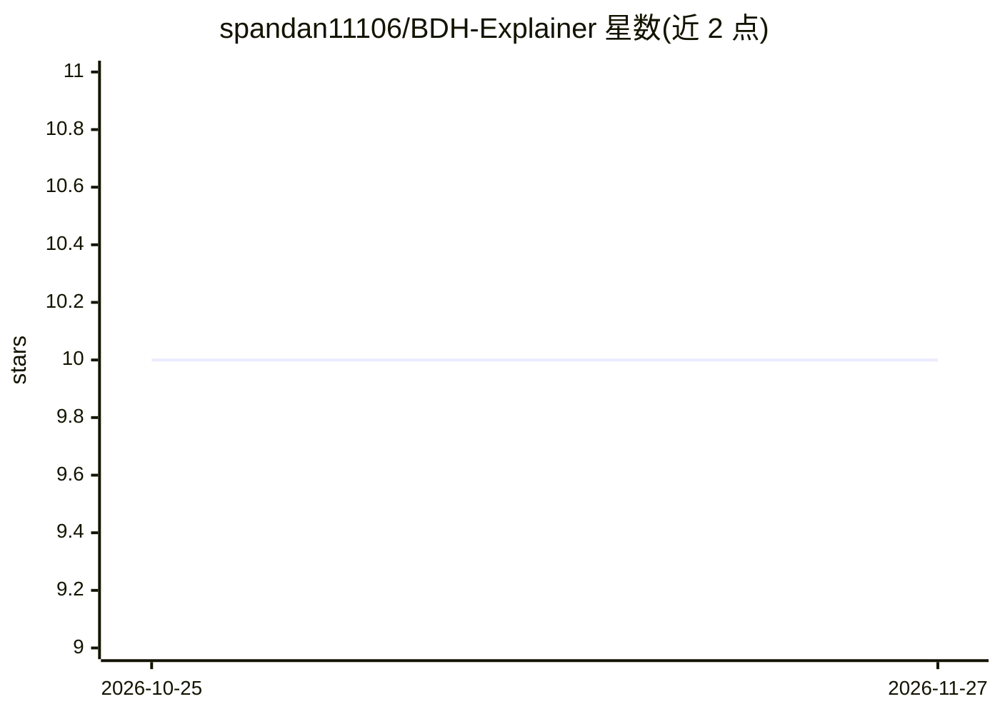

# spandan11106/BDH-Explainer

⭐ 10 · Python · MIT · 推送 2026-06-07 · [GitHub](https://github.com/spandan11106/BDH-Explainer) · [官网](https://bdh-explainer.vercel.app) · 组织维护

**实现、可视化并讲解 BDH 线性注意力架构的三合一教学项目**

三个组件：BDH-implementation 将 BDH 线性注意力应用于医学扩散模型 Bdh-DiT，从 MRI 切片预测脑肿瘤纵向进展，含训练与推理脚本及 SEAL 适配器；BDH-visualizer 是 Next.js+Three.js 前端加 FastAPI 后端的交互式应用，实时展示神经元激活、token 嵌入与下一 token 预测分布；Understanding BDH 为六部分 YouTube 教程配幻灯片。权重与数据需从 Google Drive 单独下载，训练最低需 24 GB VRAM。

## 筛选速览

| 维度 | 判定 | 备注 |
|---|---|---|
| AI 角色 | `ai-native` | 本体是模型或模型工具 |
| 许可风险 | `permissive` | MIT |
| 部署形态 | `library` | 以包/库形式分发 |
| 模型依赖 | — | README 未给出锁定关系 |
| 硬件要求 | `gpu-8g` | |
| 安装摩擦 | `medium` | 含编译或系统依赖之一 |
| 成熟度 | — | 结构信号不足 |

## 能力要点

- Bdh-DiT：BDH 线性注意力医学扩散模型，联合生成图像与分割
- 交互式 3D 可视化神经元激活、RoPE 嵌入与预测分布
- ELU+1 特征映射使内存从 O(N²) 降至 O(N)
- 六部分教程视频与幻灯片逐节讲解原论文

## 适用场景

- 在消费级 GPU 上对高分辨率医学影像做线性注意力实验
- 交互式学习 BDH 架构内部机制
- 脑肿瘤 MRI 纵向进展预测研究

## 场景标签

`教程课程` · 领域:学习与行业

## 证据(README 行号)

> L10: BDH-Explainer is a three-part project that implements, visualizes, and teaches the Baby Dragon Hatchling (BDH) arch
> L16: - **Sparse linear attention is the real strength.** The BDH blocks reduce memory growth from O(N^2) to O(N) relativ

## 星数曲线

2026-10-25 10 → 2026-11-27 10（+0）

---
*卡片 v1 · prompt 1.4 · 生成 2026-11-19 · 置信度 high · 依据 README sha `7bb32049f3b7` · [字段定义](../../DATASET.md)*
