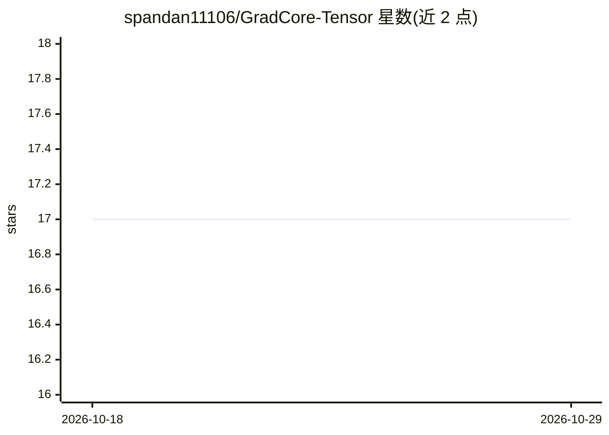

# spandan11106/GradCore-Tensor

⭐ 17 · C++ · MIT · 推送 2026-10-19 · [GitHub](https://github.com/spandan11106/GradCore-Tensor) · [官网](https://spandan11106.github.io/GradCore-Tensor/) · 个人维护

**C++ 从零实现的张量与自动微分机器学习库**

用 C++ 编写的紧凑机器学习库：核心张量运算、自动微分引擎、优化器以及基础神经网络构建模块，面向研究与示例用途。项目定位为 from-scratch 实现，README 仅提供简介与文档入口，未展示安装命令或详细使用说明。适合需要研究底层张量与自动微分实现的开发者阅读和扩展。

## 筛选速览

| 维度 | 判定 | 备注 |
|---|---|---|
| AI 角色 | `ai-ecosystem` | LLM/agent 周边工具 |
| 许可风险 | `permissive` | MIT |
| 部署形态 | `None` |  |
| 模型依赖 | — | README 未给出锁定关系 |
| 硬件要求 | — | 无带数字的原话,不猜 |
| 安装摩擦 | `low` | 无编译、无系统依赖或容器化 |
| 成熟度 | — | 结构信号不足 |

## 能力要点

- C++ 实现的核心张量运算
- 自动微分引擎
- 提供优化器与基础神经网络构建模块

## 适用场景

- 研究张量运算与自动微分的底层实现
- 在 C++ 项目中构建示例级神经网络

## 场景标签

 · 领域:机器学习框架

## 证据(README 行号)

> L3: GradientCore-Tensor is a compact C++ library providing core tensor operations, an automatic-differentiation engine, 

## 星数曲线

2026-10-18 17 → 2026-10-29 17（+0）

---
*卡片 v1 · prompt 1.4 · 生成 2026-10-29 · 置信度 mid · 依据 README sha `45c540ab25e5` · [字段定义](../../DATASET.md)*
