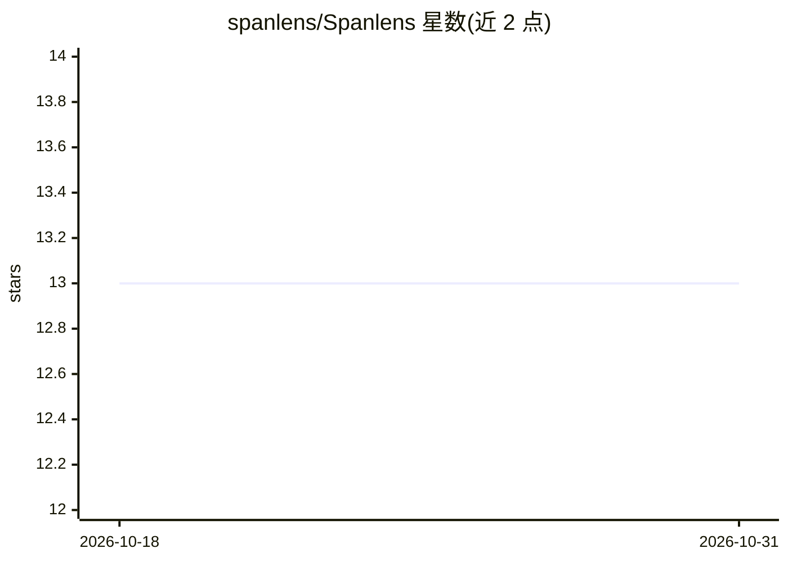

# spanlens/Spanlens

⭐ 13 · TypeScript · MIT · 推送 2026-10-26 · [GitHub](https://github.com/spanlens/Spanlens) · [官网](https://spanlens.io) · 个人维护

**面向 LLM 应用的可观测与成本监控代理，一键自托管**

开源 LLM 可观测平台：作为 drop-in 代理接管 OpenAI、Anthropic、Gemini 等请求，记录成本、token、延迟与完整 agent trace，无需改写 SDK。提供 Vercel AI SDK、LangChain、LlamaIndex 集成与 MCP server（可在 Cursor / Claude Desktop 查询）。功能含异常检测、PII 与注入扫描、prompt 版本与 A/B、LLM-as-judge 评测、响应缓存、OTLP ingest。支持 Docker 一命令自托管，也提供托管版与付费计划（MIT）。

## 筛选速览

| 维度 | 判定 | 备注 |
|---|---|---|
| AI 角色 | `ai-ecosystem` | LLM/agent 周边工具 |
| 许可风险 | `permissive` | MIT |
| 部署形态 | `self-host` | docker 或自建部署 |
| 模型依赖 | local-ok | 支持本地模型 |
| 硬件要求 | — | 无带数字的原话,不猜 |
| 安装摩擦 | `low` | 无编译、无系统依赖或容器化 |
| 成熟度 | — | 结构信号不足 |

## 能力要点

- drop-in 代理记录每次 LLM 调用的成本/token/延迟/全量请求响应
- agent tracing 含 Critical Path 与图拓扑视图
- LLM-as-judge 评测、prompt A/B（含统计显著性）与数据集回归
- Docker 一命令自托管，另有托管版与免费额度（50K req/mo）

## 适用场景

- 上线后的 LLM 应用按功能/模型/端点追踪成本与延迟
- 多步骤 agent 工作流做 trace 与瓶颈定位
- 对请求与响应做 PII、prompt 注入扫描与预算告警
- 通过 prompt A/B 与评测数据集做回归验证

## 场景标签

`LLM 可观测性` `模型评测` · 领域:评测与运维

## 证据(README 行号)

> L9: **Open-source LLM observability you can turn on in one line.** Point your OpenAI, Anthropic, or Gemini client at Spa
> L11: **Why it exists.** I shipped an LLM app on OpenAI and Gemini and hit a wall. The provider dashboards showed total s

## 星数曲线

2026-10-18 13 → 2026-10-31 13（+0）

---
*卡片 v1 · prompt 1.4 · 生成 2026-10-31 · 置信度 high · 依据 README sha `f67a270aaa44` · [字段定义](../../DATASET.md)*
