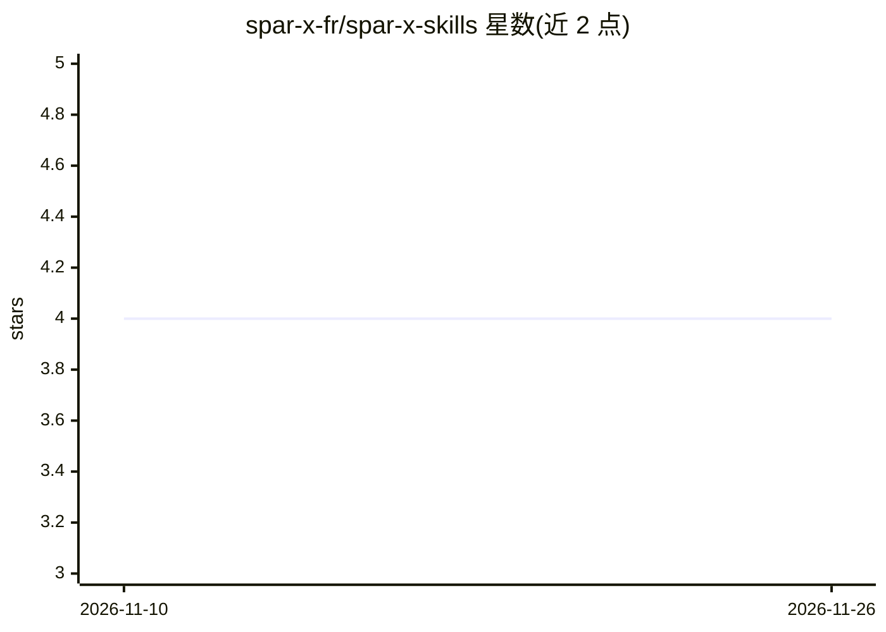

# spar-x-fr/spar-x-skills

⭐ 4 · Python · NOASSERTION · 推送 2026-11-24 · [GitHub](https://github.com/spar-x-fr/spar-x-skills) · [官网](https://www.spar-x.fr) · 组织维护

**为 Claude Code 用户提供生产就绪的技能插件，按步骤选模型控成本**

由法国培训机构 Spar-x 维护的 Claude Code 技能插件仓库，首个技能为 rightsize：以'质量优先、节约其次'的规则驱动代码 agent，在强模型上做一次深度推理，将执行与机械校验分配给轻量模型（Haiku/Sonnet/Opus 等），并按变更范围确定测试规模；按 bug、功能、重构、调研、评审、迁移、性能、文档等任务类型提供专家 playbook。通过 Claude Code 插件市场安装，也可手动复制到 ~/.claude/skills/。README 附带作者培训课程推广信息。

## 筛选速览

| 维度 | 判定 | 备注 |
|---|---|---|
| AI 角色 | `ai-ecosystem` | LLM/agent 周边工具 |
| 许可风险 | `permissive` | NOASSERTION |
| 部署形态 | `None` |  |
| 模型依赖 | — | README 未给出锁定关系 |
| 硬件要求 | — | 无带数字的原话,不猜 |
| 安装摩擦 | `low` | 无编译、无系统依赖或容器化 |
| 成熟度 | — | 结构信号不足 |

## 能力要点

- rightsize 技能按任务步骤匹配模型档位与 effort 级别
- 覆盖 bug/功能/重构/调研/评审/迁移/性能/文档 8 类任务 playbook
- 支持插件市场安装与手动复制两种安装方式
- 附 100 次经测试或 oracle 评分的基准说明（自述样本小、限于可验证任务）

## 适用场景

- 降低 Claude Code 编码 agent 的 token 消耗
- 在代码团队中统一 agent 任务质量标准
- 按任务类型套用现成的 agent 工作流 playbook

## 场景标签

`编码 Agent` `提示工程` · 领域:Agent 开发

## 证据(README 行号)

> L14: **Des skills Claude Code prêtes pour la production, sélectionnées et maintenues par Spar-x, organisme de formation 
> L37: |`rightsize`|Qualité d'abord, puis le bon plan, le bon modèle (Haiku, Sonnet, Opus, Fable), le bon niveau d'effort 

## 星数曲线

2026-11-10 4 → 2026-11-26 4（+0）

---
*卡片 v1 · prompt 1.4 · 生成 2026-11-21 · 置信度 high · 依据 README sha `b4ed4f9b944f` · [字段定义](../../DATASET.md)*
