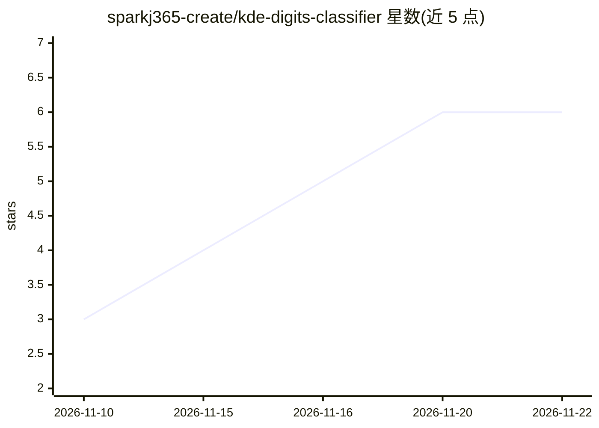

# sparkj365-create/kde-digits-classifier

⭐ 6 · Python · MIT · 推送 2026-11-09 · [GitHub](https://github.com/sparkj365-create/kde-digits-classifier) · 个人维护

**手写数字的贝叶斯 KDE 分类器库，含调参评估**

以 scikit-learn 兼容包形式实现的高斯核密度估计分类器：对每个类别估计 p(x|class) 并按贝叶斯规则分类，支持 predict、predict_proba、predict_log_proba。附带 PCA 降维与带宽联合调参、与 kNN/随机森林等基线的 5 折交叉验证对比、log-loss 评估与图表输出，模型可用 joblib 保存，提供 CLI 与 pytest 测试及 CI。面向学习或实验分类器的开发者。

## 筛选速览

| 维度 | 判定 | 备注 |
|---|---|---|
| AI 角色 | `ai-native` | 本体是模型或模型工具 |
| 许可风险 | `permissive` | MIT |
| 部署形态 | `library` | 以包/库形式分发 |
| 模型依赖 | — | README 未给出锁定关系 |
| 硬件要求 | — | 无带数字的原话,不猜 |
| 安装摩擦 | `low` | 无编译、无系统依赖或容器化 |
| 成熟度 | — | 结构信号不足 |

## 能力要点

- Gaussian KDE 估计类条件概率 + 贝叶斯规则分类
- PCA 与带宽联合调参（应对 64 维像素输入）
- 完整 scikit-learn API 兼容，通过 sklearn estimator checks
- 提供 CLI、图表输出、joblib 模型保存与测试

## 适用场景

- 在 sklearn digits 数据集上训练 KDE 分类器并输出准确率与图表
- 作为 sklearn 兼容估计器嵌入既有分类流水线
- 对比 KDE 与 kNN/随机森林等基线模型表现

## 场景标签

 · 领域:机器学习/分类

## 证据(README 行号)

> L5: A Bayesian **Kernel Density Estimation classifier** for handwritten digits, built as a clean, tested, scikit-learn-c
> L7: For each class the model estimates `p(x | class)` with a Gaussian KDE and classifies with Bayes' rule: `p(class | x)

## 星数曲线

2026-11-10 3 → 2026-11-22 6（+3）

---
*卡片 v1 · prompt 1.4 · 生成 2026-11-20 · 置信度 high · 依据 README sha `daf1088dcb51` · [字段定义](../../DATASET.md)*
