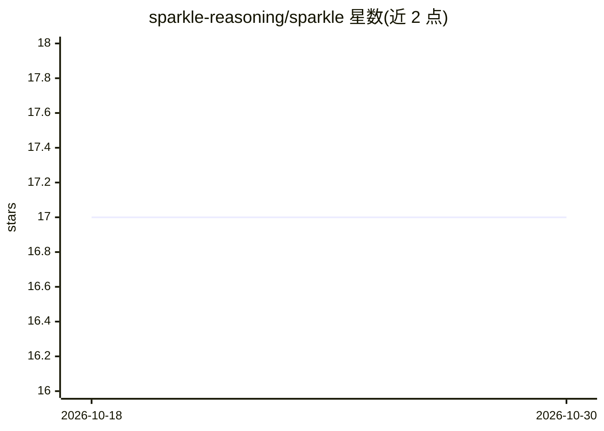

# sparkle-reasoning/sparkle

⭐ 17 · Python · MIT · 推送 2025-12-12 · [GitHub](https://github.com/sparkle-reasoning/sparkle) · [官网](https://arxiv.org/abs/2506.04723) · 组织维护

**剖析 RL 下 LLM 数学推理的评估框架与课程式训练方法**

NeurIPS'25 论文配套代码库：提供沿计划执行、知识利用、子问题分解三轴评估 LLM 数学推理的框架，并提出两阶段课程式 GRPO 训练（第一阶段全量数据、第二阶段带部分解步骤增强的难题）。基于 Qwen-2.5-Math-7B-Base 训练并发布 SparkleRL 系列 7B 检查点及 dsr40k/hardmath 数据集，附训练、FSDP 转换与评测脚本。面向复现实验或继续训练的研究者。

## 筛选速览

| 维度 | 判定 | 备注 |
|---|---|---|
| AI 角色 | `ai-ecosystem` | LLM/agent 周边工具 |
| 许可风险 | `permissive` | MIT |
| 部署形态 | `None` |  |
| 模型依赖 | — | README 未给出锁定关系 |
| 硬件要求 | — | 无带数字的原话,不猜 |
| 安装摩擦 | `medium` | 含编译或系统依赖之一 |
| 成熟度 | — | 结构信号不足 |

## 能力要点

- 三轴细粒度推理评估：计划执行/知识利用/子问题分解
- 两阶段课程式训练：难题附加部分解步骤增强
- 发布 4 个 HuggingFace 检查点与 dsr40k(40.3k)/hardmath(6.5k) 数据集
- 提供数据准备、训练、FSDP→HF 转换与评测脚本

## 适用场景

- 复现论文的 RL 数学推理训练与评测结果
- 直接使用 SparkleRL-7B 检查点做数学推理
- 研究难题增强策略对 RL 训练的作用

## 场景标签

`模型评测` `强化学习` · 领域:评测与运维

## 证据(README 行号)

> L11: **SPARKLE** is a fine-grained framework for evaluating LLM reasoning improvements under reinforcement learning (RL)
> L105: Our key innovation is a two-stage curriculum approach:

## 星数曲线

2026-10-18 17 → 2026-10-30 17（+0）

---
*卡片 v1 · prompt 1.4 · 生成 2026-10-29 · 置信度 high · 依据 README sha `9d6e900f38c3` · [字段定义](../../DATASET.md)*
