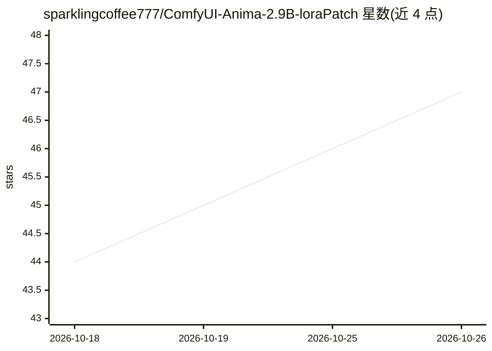

# sparklingcoffee777/ComfyUI-Anima-2.9B-loraPatch

⭐ 47 · Python · GPL-3.0 · 推送 2026-08-17 · [GitHub](https://github.com/sparklingcoffee777/ComfyUI-Anima-2.9B-loraPatch) · 个人维护

**ComfyUI 加载期补丁：将 28 块 Anima LoRA 正确映射到 40 块 Anima-2.9B**

一个不添加任何工作流节点的 ComfyUI 自定义节点补丁：在 LoRA 加载时包装 comfy.lora.load_lora，重写 key_map 中的 block 索引，使在 anima-base-v1.0（28 块）上训练的 LoRA 能按实测的层对应关系应用到块扩展后的 Anima-2.9B（40 块，原块间插入 12 新块），无需转换文件。仅当模型为 Anima、恰有 40 块且 LoRA 恰覆盖 0..27 块时才重映射，其余情况原样通过。安装方式为放入 custom_nodes 目录并重启，卸载即删文件夹。需 ComfyUI 已能完整加载 40 块模型。

## 筛选速览

| 维度 | 判定 | 备注 |
|---|---|---|
| AI 角色 | `ai-ecosystem` | LLM/agent 周边工具 |
| 许可风险 | `viral` | GPL-3.0 |
| 部署形态 | `library` | 以包/库形式分发 |
| 模型依赖 | — | README 未给出锁定关系 |
| 硬件要求 | — | 无带数字的原话,不猜 |
| 安装摩擦 | `low` | 无编译、无系统依赖或容器化 |
| 成熟度 | — | 结构信号不足 |

## 能力要点

- 包装 comfy.lora.load_lora 在加载时重写 block 索引，kohya 与 peft/AI-Toolkit 两种 LoRA 格式均适用
- 重映射映射关系由逐 tensor 比对 .safetensors 权重实测得出，28 个映射块与基础模型逐位相同
- 严格门控条件（Anima 模型 + 40 块布局 + 28 块 LoRA），不满足则原样通过
- ANIMA_LORA_REMAP 环境变量可禁用重映射

## 适用场景

- 我在 ComfyUI 里用 Anima-2.9B 时想让基于 anima-base 训练的 LoRA 命中正确的层
- 我不想离线转换 LoRA 文件，希望加载时自动映射
- 排查 LoRA 在 2.9B 上不生效或强度调高画质变差的问题

## 场景标签

 · 领域:图像生成/ComfyUI 生态

## 证据(README 行号)

> L5: A load-time patch that applies LoRAs trained on anima-base-v1.0 / anima-preview (28 blocks) to Anima-2.9B (40 blocks

## 星数曲线

2026-10-18 44 → 2026-10-26 47（+3）

---
*卡片 v1 · prompt 1.4 · 生成 2026-10-25 · 置信度 mid · 依据 README sha `811dacedb0c4` · [字段定义](../../DATASET.md)*
