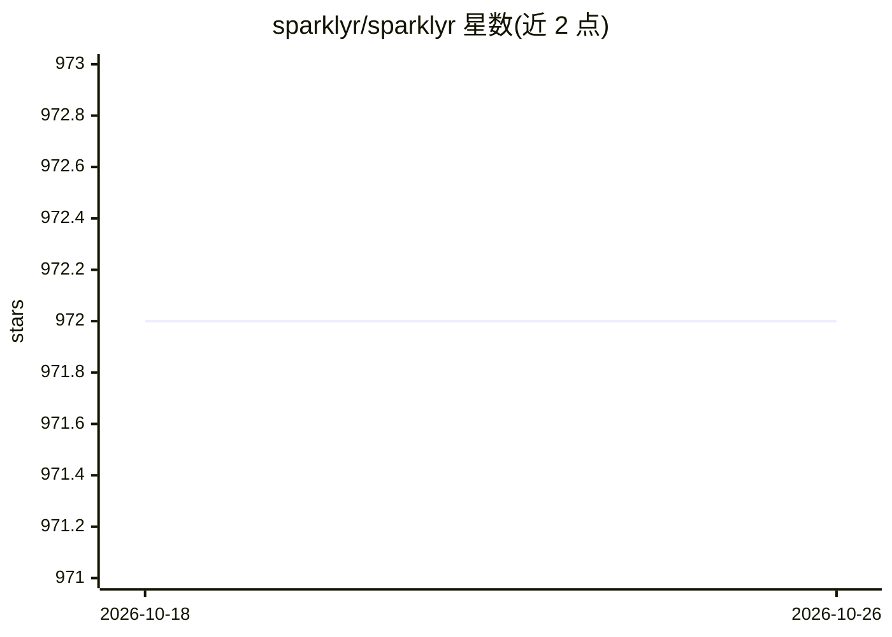

# sparklyr/sparklyr

⭐ 972 · R · Apache-2.0 · 推送 2026-10-06 · [GitHub](https://github.com/sparklyr/sparklyr) · [官网](https://spark.posit.co/) · 组织维护

**R 语言接入 Apache Spark 的接口包，用于分布式数据处理与建模**

sparklyr 是 CRAN 上的 R 包，提供到 Apache Spark 的连接与操作接口：可通过 YARN、Mesos、Livy、Kubernetes 或本地方式连接 Spark 集群；用 dplyr 动词和 SQL 对 Spark 中的数据做过滤、聚合与窗口运算；读写 CSV/JSON/Parquet（支持 HDFS、S3 与本地文件系统）；调用 Spark MLlib 的机器学习函数（如线性回归）构建与调优流水线；通过 spark_apply() 在集群上执行任意 R 代码；并提供扩展机制供第三方包接入 Spark API。RStudio IDE 内置对其的图形化支持。

## 筛选速览

| 维度 | 判定 | 备注 |
|---|---|---|
| AI 角色 | `ai-enhanced` | 去掉 AI 部分产品仍成立 |
| 许可风险 | `permissive` | Apache-2.0 |
| 部署形态 | `None` |  |
| 模型依赖 | — | README 未给出锁定关系 |
| 硬件要求 | — | 无带数字的原话,不猜 |
| 安装摩擦 | `low` | 无编译、无系统依赖或容器化 |
| 成熟度 | — | 结构信号不足 |

## 能力要点

- dplyr/SQL 远程操作 Spark 数据集与流数据
- 连接本地或远程 Spark 集群（YARN/Mesos/Livy/Kubernetes）
- 调用 Spark MLlib 机器学习算法并支持管道组合
- spark_apply() 在集群中分布式执行任意 R 代码

## 适用场景

- R 用户在 Spark 集群上用熟悉的 dplyr 语法处理大规模数据
- 在 Spark 中运行机器学习流水线并在 R 中查看结果
- 通过 Livy 或 Databricks Connect 远程访问 Spark 环境

## 场景标签

 · 领域:大数据/分布式计算

## 证据(README 行号)

> L10: - Install and connect to Spark using YARN,
> L141: You can orchestrate machine learning algorithms in a Spark cluster via

## 星数曲线

2026-10-18 972 → 2026-10-26 972（+0）

---
*卡片 v1 · prompt 1.4 · 生成 2026-10-21 · 置信度 high · 依据 README sha `c6e78b7278a5` · [字段定义](../../DATASET.md)*
