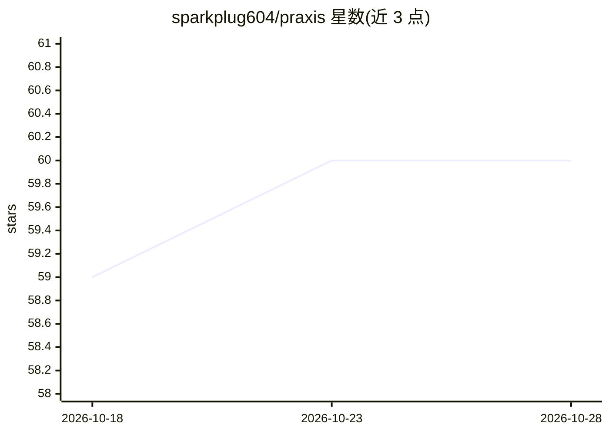

# sparkplug604/praxis

⭐ 61 · Python · MIT · 推送 2026-06-17 · [GitHub](https://github.com/sparkplug604/praxis) · 个人维护

**给 AI agent 提供可溯源共享组织记忆的本地上下文层**

面向需要跨系统上下文的团队（律所、托管服务、医疗、安全、产品与营销团队等），Praxis 将分散在文档、表格、支持系统等处的知识转化为带来源链路的可检索上下文：采集时记录来源 ID、哈希与解析质量，检索排序综合相关性、新鲜度、信任、图信号与冲突，结果可解释并可回滚。提供 Python 包与 CLI，含 Core/Reach/Agency 三层；连接器与多客户端流程为实验状态，不含托管服务、不写回源系统、非生产向量库。

## 筛选速览

| 维度 | 判定 | 备注 |
|---|---|---|
| AI 角色 | `ai-ecosystem` | LLM/agent 周边工具 |
| 许可风险 | `permissive` | MIT |
| 部署形态 | `library` | 以包/库形式分发 |
| 模型依赖 | — | README 未给出锁定关系 |
| 硬件要求 | — | 无带数字的原话,不猜 |
| 安装摩擦 | `low` | 无编译、无系统依赖或容器化 |
| 成熟度 | `idea` | |

## 能力要点

- 来源采集保留 ID、哈希、解析质量等溯源元数据
- 排序综合相关性、新鲜度、信任、图信号与冲突信号，支持 --explain 输出
- SkillGraph 变更、冲突台账、去重与回滚
- CLI 覆盖采集、索引、检索、治理、导出与多客户端胶囊

## 适用场景

- 把分散的文档与运营数据变成 agent 可检索、可溯源的记忆
- 让 agent 回答时知道依据来源、是否过期及是否存在冲突
- 多客户端场景下管理隔离的上下文胶囊

## 场景标签

`Agent 记忆` `知识图谱` · 领域:Agent 开发

## 证据(README 行号)

> L3: Praxis gives AI agents shared organizational memory.
> L7: Praxis turns scattered knowledge, operational data, and history into searchable, source-linked context that agents c
> L152: The goal is not to copy every system into Praxis. The goal is to let agents work from compact, source-linked conte

## 星数曲线

2026-10-18 59 → 2026-10-28 60（+1）

---
*卡片 v1 · prompt 1.4 · 生成 2026-10-24 · 置信度 mid · 依据 README sha `cfe64d3645a7` · [字段定义](../../DATASET.md)*
