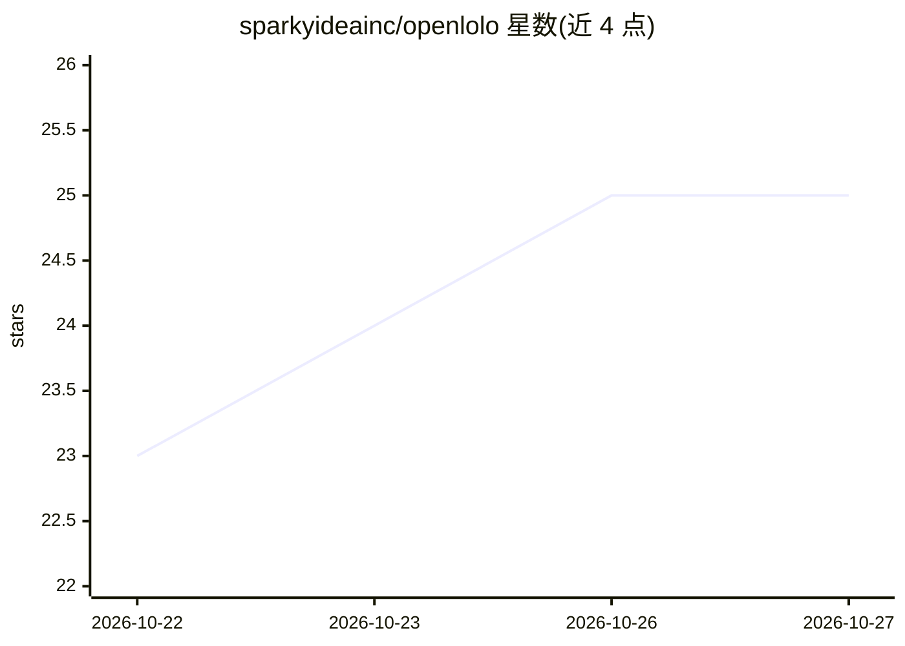

# sparkyideainc/openlolo

⭐ 25 · Python · Apache-2.0 · 推送 2026-10-26 · [GitHub](https://github.com/sparkyideainc/openlolo) · [官网](https://openlolo.com) · 组织维护

**通过 ARM64 Linux 盒子让 AI agent 观察和操作 iPhone 的开源服务**

由 Sparky Idea Inc. 维护的开源 AI 助手方案：在一台 ARM64 Linux 小主机（可用 Raspberry Pi）上运行 box 服务，绑定一台 iPhone，通过 Apple CoreDevice 服务提供原生截图、触摸、虚拟键盘、硬件按键与应用/设备信息读取。AI agent 经 MCP 协议接入执行操作，设备所有者经 box 页面逐一审批客户端。支持 Debian 13 ARM64 与 Raspberry Pi OS 64 位，提供 curl 安装脚本从 GitHub Release 下载 tarball 并校验启动。Python（box 服务）与 TypeScript（box 页面）两部分组成，Apache-2.0 许可（apps/device 例外条款见文末）。

## 筛选速览

| 维度 | 判定 | 备注 |
|---|---|---|
| AI 角色 | `ai-ecosystem` | LLM/agent 周边工具 |
| 许可风险 | `permissive` | Apache-2.0 |
| 部署形态 | `desktop` | 安装包/桌面程序 |
| 模型依赖 | — | README 未给出锁定关系 |
| 硬件要求 | — | 无带数字的原话,不猜 |
| 安装摩擦 | `low` | 无编译、无系统依赖或容器化 |
| 成熟度 | — | 结构信号不足 |

## 能力要点

- 经 Apple CoreDevice 服务提供截图、触摸、虚拟键盘、硬件按键操控
- AI agent 通过 MCP 协议接入
- 设备所有者审批每个客户端连接
- GitHub Release tarball + 校验和的一键安装脚本

## 适用场景

- 让 AI agent 在我授权下代为操作我的 iPhone
- 把树莓派改造成 iPhone 的自动化控制盒子
- 构建需要观察与操作 iOS 界面的 agent 工作流

## 场景标签

`GUI 自动化` · 领域:效率与自动化

## 证据(README 行号)

> L4: A small ARM64 Linux box (a Raspberry Pi works) is bound to one iPhone and lets AI agents
> L6: a virtual keyboard, hardware buttons, and app and device information. Agents connect over
> L20: Supported platforms: Debian 13 ARM64 and Raspberry Pi OS 64-bit.

## 星数曲线

2026-10-22 23 → 2026-10-27 25（+2）

---
*卡片 v1 · prompt 1.4 · 生成 2026-10-26 · 置信度 mid · 依据 README sha `fd047fad52b9` · [字段定义](../../DATASET.md)*
