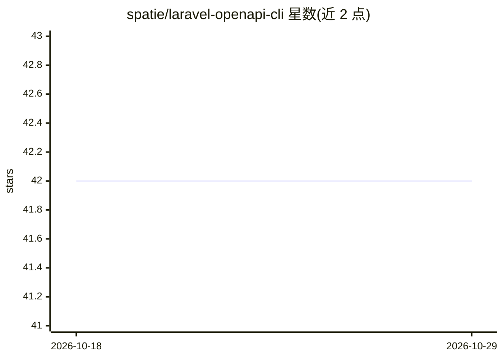

# spatie/laravel-openapi-cli

⭐ 42 · PHP · MIT · 推送 2026-10-22 · [GitHub](https://github.com/spatie/laravel-openapi-cli) · [官网](https://spatie.be/open-source) · 组织维护

**把 OpenAPI 规格生成为 Laravel artisan 命令的 CLI 工具包**

spatie 维护的 Laravel 扩展包：读取 OpenAPI 规格文件（YAML，可来自 URL），为每个 endpoint 生成带类型化选项（路径参数、查询参数、请求体）的独立 artisan 命令，如 bookstore:get-books、bookstore:post-books 等，并自动生成 list 命令。配合 Laravel Zero 可构建面向任意 OpenAPI API 的独立 CLI 工具。面向 PHP/Laravel 开发者，MIT 许可。README 未提及任何 AI 功能。

## 筛选速览

| 维度 | 判定 | 备注 |
|---|---|---|
| AI 角色 | `ai-ecosystem` | LLM/agent 周边工具 |
| 许可风险 | `permissive` | MIT |
| 部署形态 | `None` |  |
| 模型依赖 | — | README 未给出锁定关系 |
| 硬件要求 | — | 无带数字的原话,不猜 |
| 安装摩擦 | `low` | 无编译、无系统依赖或容器化 |
| 成熟度 | — | 结构信号不足 |

## 能力要点

- 读取 OpenAPI 规格并为每个 endpoint 生成独立 artisan 命令
- 命令选项覆盖路径参数、查询参数与请求体且带类型
- 可与 Laravel Zero 组合构建独立 CLI 工具

## 适用场景

- 我想为有 OpenAPI 规格的 API 快速生成命令行调用工具
- 在 Laravel 项目中以 artisan 命令直接调试 API endpoint

## 场景标签

`代码生成` · 领域:编码与开发

## 证据(README 行号)

> L7:  Create Laravel commands for your OpenAPI specs
> L14: Turn any OpenAPI spec into dedicated Laravel artisan commands. Each endpoint gets its own command with typed option

## 星数曲线

2026-10-18 42 → 2026-10-29 42（+0）

---
*卡片 v1 · prompt 1.4 · 生成 2026-10-25 · 置信度 low · 依据 README sha `b5f0a02bfafc` · [字段定义](../../DATASET.md)*
