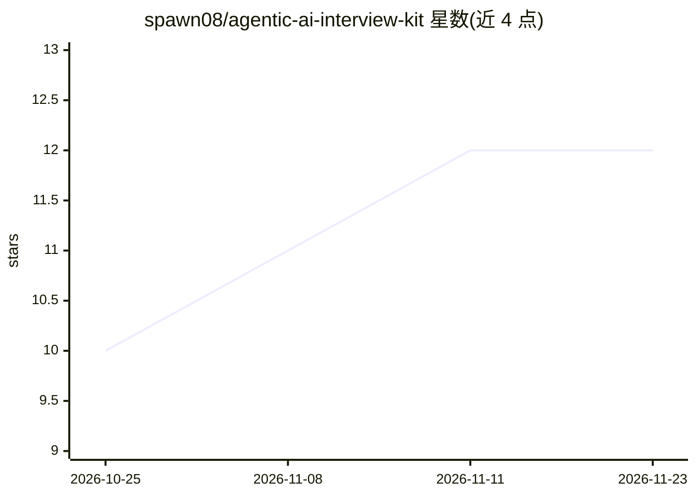

# spawn08/agentic-ai-interview-kit

⭐ 12 · HTML · 推送 2026-10-14 · [GitHub](https://github.com/spawn08/agentic-ai-interview-kit) · [官网](https://spawn08.github.io/agentic-ai-interview-kit/) · 个人维护

**面向工程师的 Agentic AI 面试与系统设计学习指南**

以 Docusaurus 静态站点形式发布的开源学习指南，包含 60+ 页内容，分为七个递进章节：LLM 基础、Agent 核心概念、ReAct/反思/多 Agent 等设计模式、主流框架走读、可运行实现（ReAct agent、RAG agent、评估 harness）、系统设计原则与 13+ 个案例研究，以及面试题库。面向准备面试的工程师和构建 agentic 系统的从业者，提供按经验水平选择的入门路径与学习时长估计。

## 筛选速览

| 维度 | 判定 | 备注 |
|---|---|---|
| AI 角色 | `ai-knowledge` | 知识聚合/清单类 |
| 许可风险 | `permissive` | — |
| 部署形态 | `None` |  |
| 模型依赖 | — | README 未给出锁定关系 |
| 硬件要求 | — | 无带数字的原话,不猜 |
| 安装摩擦 | `low` | 无编译、无系统依赖或容器化 |
| 成熟度 | — | 结构信号不足 |

## 能力要点

- 60+ 页内容覆盖理论、设计模式、框架与可运行代码
- 7 个递进章节与按经验水平的入门路径及时长估计
- 13+ 个系统设计案例研究与分类面试题库
- Docusaurus 3 站点支持本地搜索与热重载

## 适用场景

- 准备 agentic AI 相关岗位的面试
- 系统学习从 LLM 基础到生产级 agent 系统设计
- 查找客户支持、代码助手等场景的系统设计案例参考

## 场景标签

`教程课程` · 领域:学习与行业

## 证据(README 行号)

> L8: **The comprehensive, open-source study guide for mastering agentic AI -- from foundations to production system desig
> L16: This project fills that gap with **60+ in-depth pages** covering theory, design patterns, framework walkthroughs, r

## 星数曲线

2026-10-25 10 → 2026-11-23 12（+2）

---
*卡片 v1 · prompt 1.4 · 生成 2026-11-18 · 置信度 high · 依据 README sha `c5b688b5d82f` · [字段定义](../../DATASET.md)*
