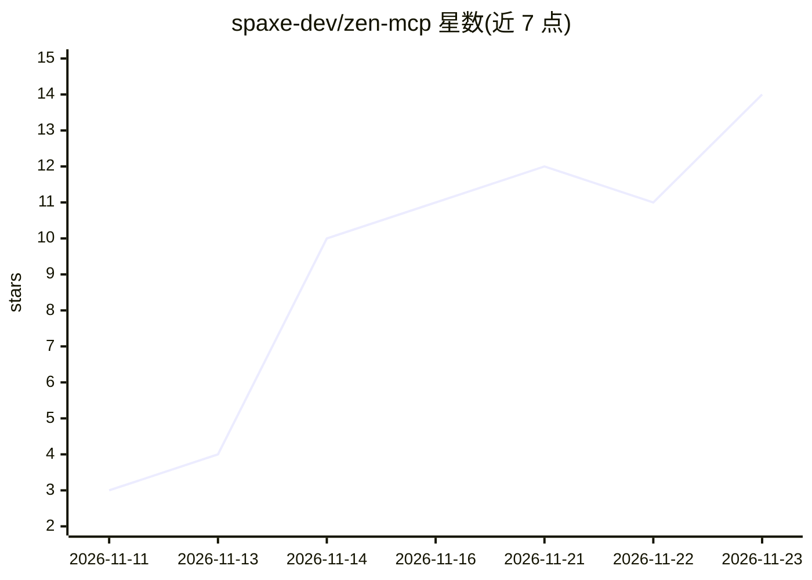

# spaxe-dev/zen-mcp

⭐ 14 · TypeScript · MIT · 推送 2026-11-22 · [GitHub](https://github.com/spaxe-dev/zen-mcp) · 个人维护

**让 AI agent 在 Zen Browser 内受控操作的 MCP 服务器**

一个 MCP 服务器，通过 Zen 浏览器的 Marionette 接口让 AI agent 在浏览器内工作：后台打开与读取标签页、搜索页面、操作原生 spaces/文件夹/固定标签等 Zen 结构、在浏览器卡片中提问并展示证据。通过每次启动的 nonce 校验自有浏览器边界，提供只读模式、域名白名单、JSONL 审计日志与全局 Pause。当前为 0.4.x pre-1.0，API 与配置键可能变化；仅 Windows 平台有实测验证的 Zen 启动，macOS/Linux 仅通过 CI 测试。

## 筛选速览

| 维度 | 判定 | 备注 |
|---|---|---|
| AI 角色 | `ai-ecosystem` | LLM/agent 周边工具 |
| 许可风险 | `permissive` | MIT |
| 部署形态 | `library` | 以包/库形式分发 |
| 模型依赖 | — | README 未给出锁定关系 |
| 硬件要求 | — | 无带数字的原话,不猜 |
| 安装摩擦 | `low` | 无编译、无系统依赖或容器化 |
| 成熟度 | `idea` | |

## 能力要点

- 53 个工具、5 个资源、3 个 prompt，结果带类型与结构化输出
- Evidence Mode 在浏览器中定位引文并用只读覆盖层标记
- 自有浏览器边界：nonce 校验、关闭 Marionette 监听、一次性会话批准
- 只读模式、域名白名单、审计日志等模型外策略控制

## 适用场景

- 让 MCP 客户端里的 agent 在后台批量阅读网页并产出带出处的小结
- 用 agent 管理 Zen 浏览器的 spaces、文件夹与标签页组织
- 需要明确边界（可暂停、可只读）的浏览器自动化任务

## 场景标签

`浏览器自动化` · 领域:效率与自动化

## 证据(README 行号)

> L11: Zen MCP is an MCP server that lets an AI agent work inside Zen Browser using Zen's own spaces, folders, and tabs. T
> L31: - **People using an MCP client** such as Claude Code, Cursor, or another client that can launch a stdio server.

## 星数曲线

2026-11-11 3 → 2026-11-23 14（+11）

---
*卡片 v1 · prompt 1.4 · 生成 2026-11-18 · 置信度 high · 依据 README sha `38c17c0e4bc8` · [字段定义](../../DATASET.md)*
