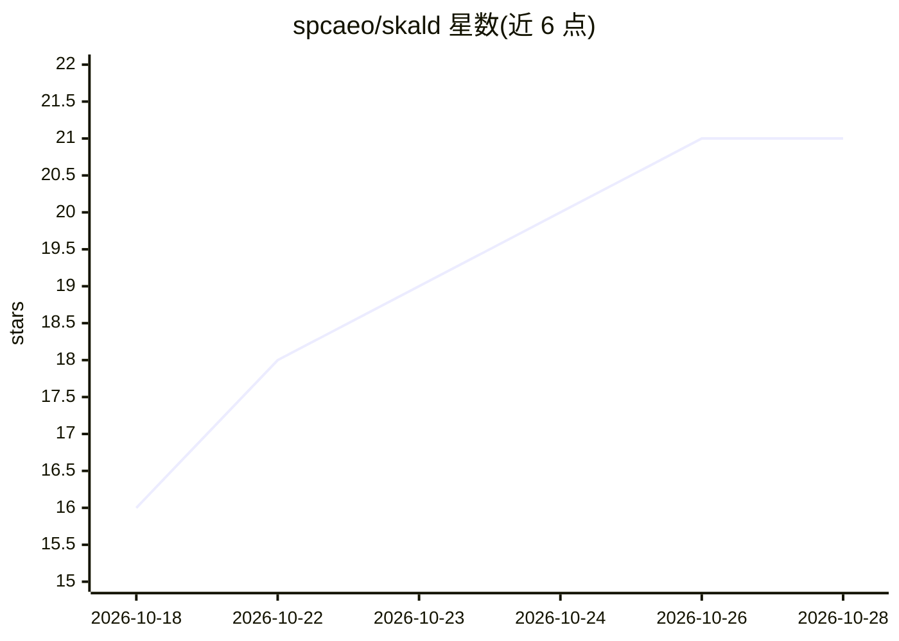

# spcaeo/skald

⭐ 21 · Python · NOASSERTION · 推送 2026-10-28 · [GitHub](https://github.com/spcaeo/skald) · [官网](https://skaldanalytics.com) · 组织维护

**基于服务器访问日志的自托管网站分析与安全监控工具**

读取 Web 服务器访问日志（nginx/Apache/Caddy、CDN、Vercel/Netlify 等）做无 Cookie 的自托管网站分析：把每个请求归入人、AI 助手、搜索引擎、机器人/扫描器、自有流量五组并保证加总一致；按名称识别 GPTBot、ClaudeBot 等爬虫并通过官方地址/DNS 核验身份，将来自 AI 回答的直接访问标注为'可能来自该助手'。独立审计层用第二套解析器复核每个数字，不一致则扣留当日数据。同一日志还输出安全面板：暴露探测、扫描者、攻击尝试、虚假浏览器、组件公告与封锁清单，但明确不阻断流量、非 WAF。提供线索/转化跟踪、实时地图、Slack/邮件告警、JSON API 与 MCP 服务器，可 Docker 部署；采用 Elastic License 2.0，另有托管 beta。

## 筛选速览

| 维度 | 判定 | 备注 |
|---|---|---|
| AI 角色 | `ai-enhanced` | 去掉 AI 部分产品仍成立 |
| 许可风险 | `none` | NOASSERTION |
| 部署形态 | `desktop` | 安装包/桌面程序 |
| 模型依赖 | — | README 未给出锁定关系 |
| 硬件要求 | — | 无带数字的原话,不猜 |
| 安装摩擦 | `low` | 无编译、无系统依赖或容器化 |
| 成熟度 | `idea` | |

## 能力要点

- 五组流量分类且与日志总量精确吻合，每个数字由独立审计二次清点
- 按名称识别 AI 爬虫并以官方地址/DNS 核验，假冒者单独归类
- 同一日志输出安全面板：扫描者、攻击尝试、暴露探测、公告与封锁清单
- 支持 nginx/Apache/Caddy/CDN/Vercel/Netlify/Cloudflare Worker 等多种日志输入，Python 3.11+ 零依赖

## 适用场景

- 不装脚本、不用 Cookie 地统计包括 AI 爬虫在内的全部站点流量
- 看清有多少访客来自 ChatGPT、Perplexity 等 AI 助手的回答引用
- 从访问日志发现扫描器对 .env、AI 凭证等敏感路径的探测

## 场景标签

`网络安全` `数据分析` · 领域:效率与自动化

## 证据(README 行号)

> L8:  Web analytics from your server's own access log: the people, the AI assistants and the crawlers
> L43: Skald reads the one record that sees every visit: **your web server's access log.** Every request
> L154: - **The dashboard:** six sections (Overview, Traffic, Leads & sales, AI & bots, Security, Site);

## 星数曲线

2026-10-18 16 → 2026-10-28 21（+5）

---
*卡片 v1 · prompt 1.4 · 生成 2026-10-28 · 置信度 mid · 依据 README sha `6d08b2a47ff3` · [字段定义](../../DATASET.md)*
