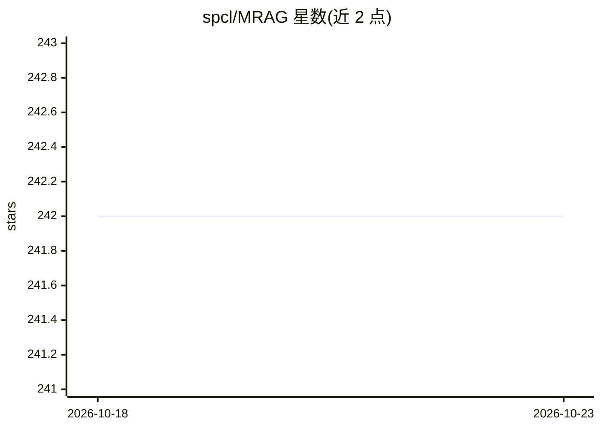

# spcl/MRAG

⭐ 242 · Python · NOASSERTION · 推送 2026-02-26 · [GitHub](https://github.com/spcl/MRAG) · [官网](http://arxiv.org/abs/2406.05085) · 组织维护

**Multi-Head RAG 论文官方实现：用注意力头激活做多方面检索**

论文 "Multi-Head RAG: Solving Multi-Aspect Problems with LLMs" 的官方实现：针对需一次取回内容差异大的多篇文档的查询，改用 Transformer 多头注意力层的激活（而非 decoder 层输出）作为嵌入键，以捕捉数据的不同侧面并提升复杂查询的检索精度。面向科研复现：提供 CLI 生成合成数据集/查询（查询生成调用 OpenAI LLM，产生费用）、用 SFR-Embedding-Mistral 生成嵌入、导入向量数据库并运行多种检索策略评估与绘图；也附带论文所用 Wikipedia 数据集。

## 筛选速览

| 维度 | 判定 | 备注 |
|---|---|---|
| AI 角色 | `ai-ecosystem` | LLM/agent 周边工具 |
| 许可风险 | `none` | NOASSERTION |
| 部署形态 | `library` | 以包/库形式分发 |
| 模型依赖 | — | README 未给出锁定关系 |
| 硬件要求 | — | 无带数字的原话,不猜 |
| 安装摩擦 | `low` | 无编译、无系统依赖或容器化 |
| 成熟度 | — | 结构信号不足 |

## 能力要点

- 以多头注意力层激活替代 decoder 输出作为嵌入键
- CLI 覆盖 datagen/querygen/embed/db/evaluate/plot 全流程
- 提供论文评估所用的 Wikipedia 数据集与查询，可跳过付费生成
- 默认使用 Salesforce/SFR-Embedding-Mistral 嵌入模型

## 适用场景

- 复现论文的 Multi-Head RAG 检索实验结果
- 研究多方面查询下不同检索策略的准确率对比
- 基于合成或 Wikipedia 数据集开展 RAG 检索评估

## 场景标签

 · 领域:RAG/信息检索研究

## 证据(README 行号)

> L5: This framework implements Multi-Head RAG (MRAG), a novel scheme focused on
> L10: leveraging activations of Transformer's multi-head attention layer, instead of
> L71: multirag-cli evaluate

## 星数曲线

2026-10-18 242 → 2026-10-23 242（+0）

---
*卡片 v1 · prompt 1.4 · 生成 2026-10-22 · 置信度 mid · 依据 README sha `c4beb696cb2b` · [字段定义](../../DATASET.md)*
