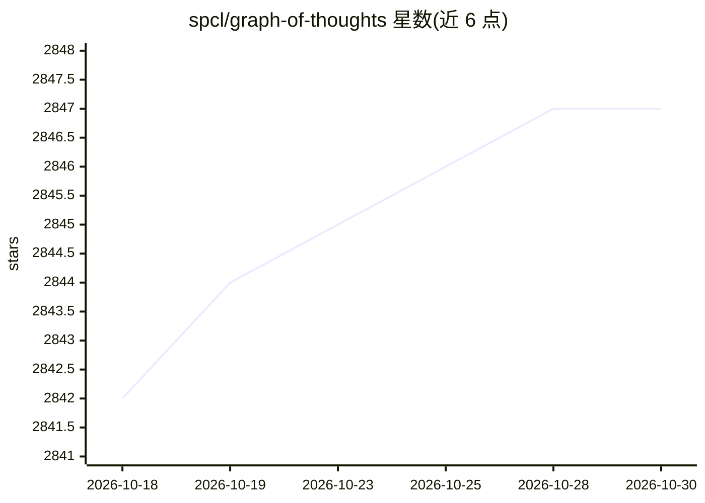

# spcl/graph-of-thoughts

⭐ 2,847 · Python · NOASSERTION · 推送 2026-03-24 · [GitHub](https://github.com/spcl/graph-of-thoughts) · [官网](https://arxiv.org/pdf/2308.09687.pdf) · 组织维护

**把问题建模为操作图并用 LLM 自动执行的提示工程框架**

论文 Graph of Thoughts 的官方实现，来自 ETH（spcl）团队。框架将复杂问题建模为 Graph of Operations（GoO），由 LLM 作为引擎自动执行，支持实现 GoT、CoT、ToT 等推理结构。以 Python 库形式提供（要求 Python 3.8+），需自行配置可访问的 LLM（见 Controller README）。examples 目录含排序、关键词计数等论文示例，可运行并复现论文实验结果。

## 筛选速览

| 维度 | 判定 | 备注 |
|---|---|---|
| AI 角色 | `ai-ecosystem` | LLM/agent 周边工具 |
| 许可风险 | `none` | NOASSERTION |
| 部署形态 | `library` | 以包/库形式分发 |
| 模型依赖 | — | README 未给出锁定关系 |
| 硬件要求 | — | 无带数字的原话,不猜 |
| 安装摩擦 | `low` | 无编译、无系统依赖或容器化 |
| 成熟度 | — | 结构信号不足 |

## 能力要点

- 以 Graph of Operations 建模并由 LLM 引擎自动执行
- 支持实现 GoT 及 CoT/ToT 等已有推理结构
- 提供排序、关键词计数等可运行示例与论文实验复现入口
- 可通过 PyPI 安装，也可从源码以可编辑模式安装

## 适用场景

- 用图结构提示策略解决排序、关键词计数等复杂任务
- 对比 CoT 与 GoT 方法的输出结果
- 复现论文中的实验结果

## 场景标签

`提示工程` · 领域:Agent 开发

## 证据(README 行号)

> L3: This is the official implementation of Graph of Thoughts: Solving Elaborate Problems with Large Language Models.
> L4: This framework gives you the ability to solve complex problems by modeling them as a Graph of Operations (GoO), whic

## 星数曲线

2026-10-18 2,842 → 2026-10-30 2,847（+5）

---
*卡片 v1 · prompt 1.4 · 生成 2026-10-21 · 置信度 high · 依据 README sha `4dfe69feee0a` · [字段定义](../../DATASET.md)*
