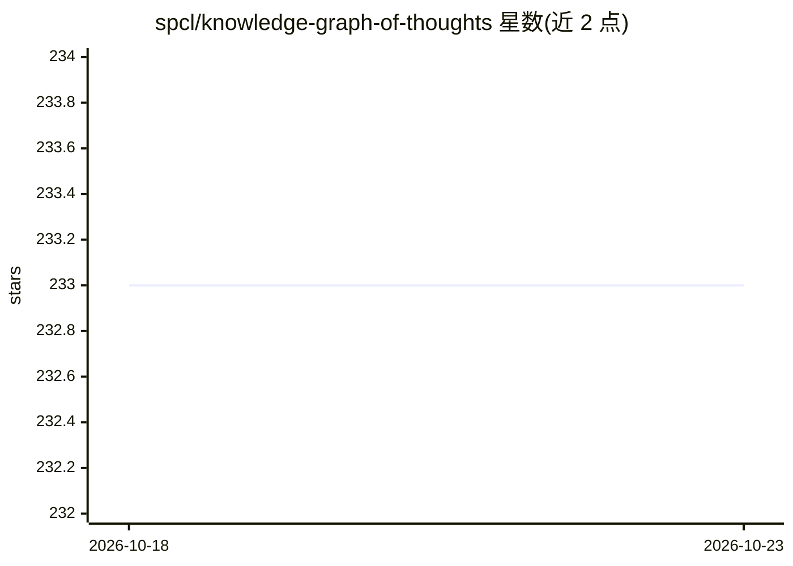

# spcl/knowledge-graph-of-thoughts

⭐ 233 · Python · NOASSERTION · 推送 2026-07-28 · [GitHub](https://github.com/spcl/knowledge-graph-of-thoughts) · [官网](http://arxiv.org/abs/2504.02670) · 组织维护

**AI 助手架构：把任务知识构建为动态知识图谱辅助 LLM 推理**

论文 Affordable AI Assistants with Knowledge Graph of Thoughts 的官方实现。框架由 Controller、Graph Store、Integrated Tools 三部分组成：将任务相关知识抽取为动态知识图谱，并通过数学求解器、网页爬虫、Python 脚本等工具迭代增强，使低成本模型可处理复杂任务。知识图谱后端支持 Neo4j、NetworkX、RDF4J；本地模型经 Ollama 托管接入，容器化执行保障安全。主要面向科研评测（GAIA、SimpleQA 基准），也可用 kgot 命令求解单个任务。需要 Python 3.10+，配置 API key，容器构建约 15 分钟。

## 筛选速览

| 维度 | 判定 | 备注 |
|---|---|---|
| AI 角色 | `ai-ecosystem` | LLM/agent 周边工具 |
| 许可风险 | `none` | NOASSERTION |
| 部署形态 | `self-host` | docker 或自建部署 |
| 模型依赖 | local-ok | 支持本地模型 |
| 硬件要求 | — | 无带数字的原话,不猜 |
| 安装摩擦 | `low` | 无编译、无系统依赖或容器化 |
| 成熟度 | — | 结构信号不足 |

## 能力要点

- 知识图谱后端支持 Neo4j、NetworkX、RDF4J，可选直接/查询式检索
- 集成数学求解器、网页爬虫、Python 代码等外部工具的多模态推理
- Neo4j/RDF4J/代码工具容器化执行 LLM 生成代码
- kgot 命令行可直接求解单个任务并传入文件

## 适用场景

- 在 GAIA、SimpleQA 基准上评测知识图谱推理方法
- 研究者复现论文实验结果
- 用低成本模型处理需要结构化推理的复杂任务

## 场景标签

`知识图谱` `Agent 框架` · 领域:Agent 开发

## 证据(README 行号)

> L8: This is the official implementation of Affordable AI Assistants with Knowledge Graph of Thoughts.
> L10: Knowledge Graph of Thoughts (KGoT) is an innovative AI assistant architecture that integrates LLM reasoning with dy
> L11: KGoT extracts and structures task-relevant knowledge into a dynamic KG representation, iteratively enhanced through
> L16: The KGoT system is designed as a modular and flexible framework that consists of three main components: the **Contr

## 星数曲线

2026-10-18 233 → 2026-10-23 233（+0）

---
*卡片 v1 · prompt 1.4 · 生成 2026-10-22 · 置信度 high · 依据 README sha `76b3ba8143d9` · [字段定义](../../DATASET.md)*
