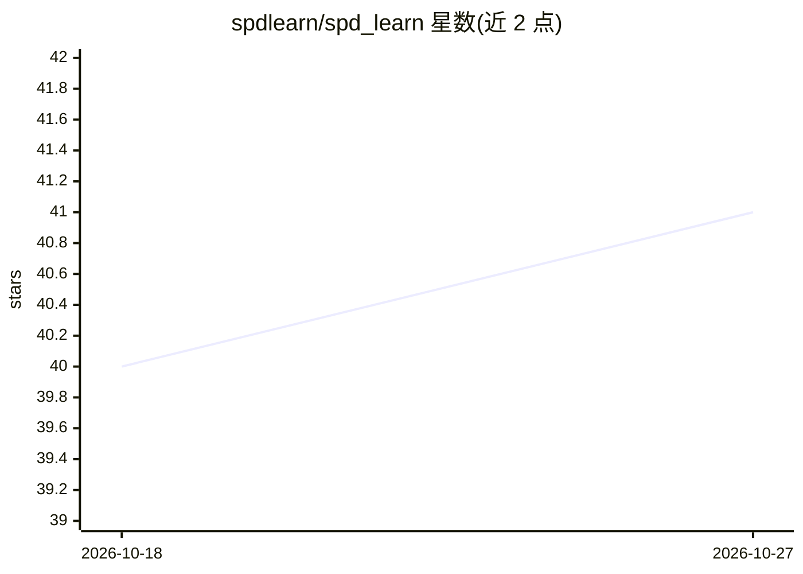

# spdlearn/spd_learn

⭐ 41 · Python · BSD-3-Clause · 推送 2026-10-19 · [GitHub](https://github.com/spdlearn/spd_learn) · [官网](http://spdlearn.org/) · 组织维护

**面向 BCI/EEG 神经解码的 SPD 矩阵几何深度学习 PyTorch 库**

纯 PyTorch 实现的对称正定（SPD）矩阵几何深度学习库：提供可微分的黎曼运算（指数/对数映射、测地距离、Log-Euclidean 均值）、广播兼容的 SPD 层（BiMap/ReEig/LogEig）以及已发表论文架构的参考实现（SPDNet、EEGSPDNet、TSMNet、TensorCSPNet、PhaseSPDNet、GREEN）。支持 CUDA 批量运算，可经 skorch/Braindecode 包装接入 scikit-learn 流水线，兼容 MOABB 基准与 pyRiemann。面向从事 EEG/BCI 与神经解码研究的科研人员，需 Python 3.11+ 与 PyTorch 2.0+。

## 筛选速览

| 维度 | 判定 | 备注 |
|---|---|---|
| AI 角色 | `ai-native` | 本体是模型或模型工具 |
| 许可风险 | `permissive` | BSD-3-Clause |
| 部署形态 | `library` | 以包/库形式分发 |
| 模型依赖 | — | README 未给出锁定关系 |
| 硬件要求 | — | 无带数字的原话,不猜 |
| 安装摩擦 | `medium` | 含编译或系统依赖之一 |
| 成熟度 | — | 结构信号不足 |

## 能力要点

- 可微分的黎曼运算工具集：指数/对数映射、平行传输、测地距离
- 多个已发表 SPD 架构的参考实现（SPDNet/EEGSPDNet/TSMNet 等 6 种）
- 完整 CUDA 支持与批量化的 SPD 批归一化层
- 经 skorch/Braindecode 包装接入 scikit-learn 流水线，兼容 MOABB 基准

## 适用场景

- 在 EEG/BCI 任务上训练 SPD 流形神经网络做运动想象等分类
- 在研究中复现或对比已发表的 SPD 架构
- 用 MOABB 基准数据评测黎曼几何解码方法

## 场景标签

`科研工具` · 领域:学习与行业

## 证据(README 行号)

> L5:  SPD Learn is a pure PyTorch library for geometric deep learning on Symmetric Positive Definite (SPD) matrices.
> L33: |**EEGSPDNet**|Specialized for EEG signal classification. Combines covariance estimation with SPD network layers fo

## 星数曲线

2026-10-18 40 → 2026-10-27 41（+1）

---
*卡片 v1 · prompt 1.4 · 生成 2026-10-25 · 置信度 high · 依据 README sha `1082b9eddf69` · [字段定义](../../DATASET.md)*
