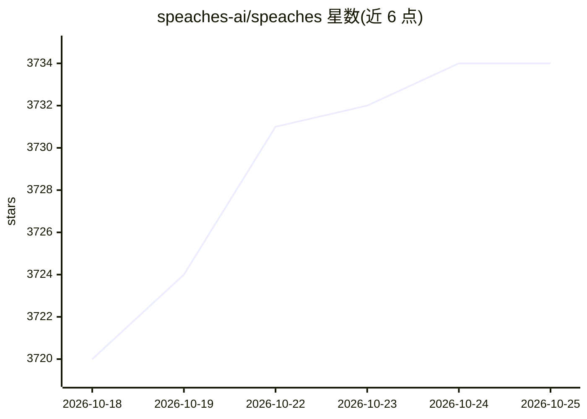

# speaches-ai/speaches

⭐ 3,734 · Python · MIT · 推送 2026-10-22 · [GitHub](https://github.com/speaches-ai/speaches) · [官网](https://speaches.ai/) · 组织维护

**OpenAI API 兼容的语音转录/翻译/TTS 推理服务器**

提供 OpenAI API 兼容的 HTTP 服务器，覆盖流式语音转录、翻译与语音生成：STT 由 faster-whisper 驱动，TTS 使用 piper 与 Kokoro 模型。支持通过 chat completions 端点做文本转音频、音频转文本 sentiment 摘要及语音到语音交互；模型可按请求动态加载/卸载，支持 GPU 与 CPU、Docker 部署和 Realtime API。定位为『TTS/STT 版的 Ollama』，安装文档见 speaches.ai。

## 筛选速览

| 维度 | 判定 | 备注 |
|---|---|---|
| AI 角色 | `ai-ecosystem` | LLM/agent 周边工具 |
| 许可风险 | `permissive` | MIT |
| 部署形态 | `self-host` | docker 或自建部署 |
| 模型依赖 | — | README 未给出锁定关系 |
| 硬件要求 | — | 无带数字的原话,不猜 |
| 安装摩擦 | `low` | 无编译、无系统依赖或容器化 |
| 成熟度 | — | 结构信号不足 |

## 能力要点

- OpenAI API 兼容，现有 OpenAI 工具与 SDK 可直接使用
- 流式转录经 SSE 实时返回
- 按请求动态加载/卸载模型
- TTS 由 Kokoro 与 piper 驱动，支持 GPU/CPU 与 Docker 部署

## 适用场景

- 给应用提供本地 OpenAI 兼容的转录/翻译/TTS API
- 搭建可动态切换模型的语音服务后端
- 用现有 OpenAI SDK 接入流式语音转录

## 场景标签

`语音合成` `语音识别` `推理引擎` · 领域:内容生成

## 证据(README 行号)

> L3: `speaches` is an OpenAI API-compatible server supporting streaming transcription, translation, and speech generation
> L9: - OpenAI API compatible. All tools and SDKs that work with OpenAI's API should work with `speaches`.

## 星数曲线

2026-10-18 3,720 → 2026-10-25 3,734（+14）

---
*卡片 v1 · prompt 1.4 · 生成 2026-10-20 · 置信度 high · 依据 README sha `3d2e3427dcfa` · [字段定义](../../DATASET.md)*
