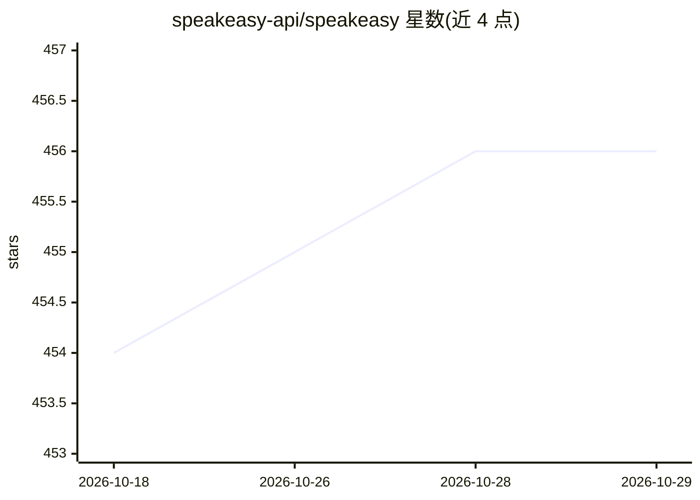

# speakeasy-api/speakeasy

⭐ 456 · JavaScript · NOASSERTION · 推送 2026-10-28 · [GitHub](https://github.com/speakeasy-api/speakeasy) · [官网](https://speakeasy.com) · 组织维护

**面向 API 团队的 OpenAPI 工具链：生成多语言 SDK 与 Terraform Provider**

Speakeasy 提供以 OpenAPI 3.X 为输入的开发工具链：生成 10 种语言的类型安全 SDK（TypeScript/Python/Go/Java/C#/PHP/Ruby/Unity 等）、基于 Go SDK 的 Terraform Provider、基于 Arazzo 的契约测试与内置 mock server，并支持 lint/clean/diff OpenAPI 规范（基于 Overlays）、代码示例同步与包管理器发布管理。CLI 可经 Homebrew/Winget/Chocolatey/Shell 脚本/Docker 安装；另提供 Agent Skills 包供 Claude Code、Cursor、GitHub Copilot 等 AI 编码代理调用其功能。

## 筛选速览

| 维度 | 判定 | 备注 |
|---|---|---|
| AI 角色 | `ai-enhanced` | 去掉 AI 部分产品仍成立 |
| 许可风险 | `none` | NOASSERTION |
| 部署形态 | `library` | 以包/库形式分发 |
| 模型依赖 | — | README 未给出锁定关系 |
| 硬件要求 | — | 无带数字的原话,不猜 |
| 安装摩擦 | `low` | 无编译、无系统依赖或容器化 |
| 成熟度 | — | 结构信号不足 |

## 能力要点

- 从 OpenAPI 生成 10 种语言的类型安全 SDK
- 生成 Terraform Provider 与契约测试（Arazzo + mock server）
- OpenAPI 3.X 规范的 lint/清理/diff/编辑工具链（Overlays）
- Agent Skills 包支持 Claude Code、Cursor、GitHub Copilot 等 15+ 平台的 AI 编码代理

## 适用场景

- 为自家 API 生成并发布多语言 SDK
- 从 OpenAPI 规范构建 Terraform Provider
- 在 AI 编码代理中通过技能命令初始化和再生成 SDK 项目

## 场景标签

`代码生成` · 领域:编码与开发

## 证据(README 行号)

> L49:  Polished and type-safe SDKs, Terraform providers and Contract Tests for your API. 10 Languages and counting.
> L115: - SDK code that looks like you wrote it. Optimised for performance, debuggability and modern idiomatics.

## 星数曲线

2026-10-18 454 → 2026-10-29 456（+2）

---
*卡片 v1 · prompt 1.4 · 生成 2026-10-22 · 置信度 mid · 依据 README sha `c4ce0c0e2c48` · [字段定义](../../DATASET.md)*
