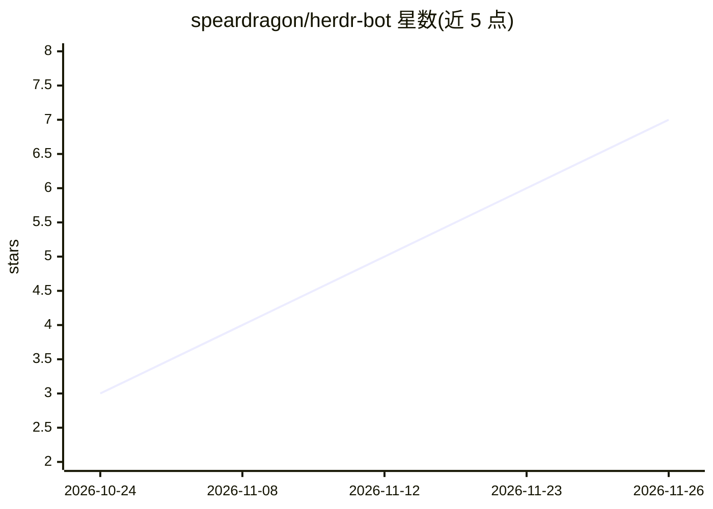

# speardragon/herdr-bot

⭐ 7 · TypeScript · MIT · 推送 2026-10-21 · [GitHub](https://github.com/speardragon/herdr-bot) · [官网](https://github.com/speardragon/herdr-bot/releases/latest) · 个人维护 · 中文 README

**让 Claude Code/Codex/Grok 等 agent 以 bot 身份互相聊天的 macOS 应用**

herdr-bot 将 herdr 会话中运行的 agent CLI（Claude Code、Codex、Grok、OpenCode 等）封装为命名的 bot，提供 DM 与最多六人的房间聊天界面；消息成为 agent 的下一条 prompt，bot 之间可通过 @mention 与 CLI 命令转交工作，权限提示以卡片形式在聊天中一键批准。本地 Electron 应用加 herdr 插件两种形态，无云运行时与内置账号计费；依赖已安装并登录的 herdr 与对应 agent CLI，仅支持 macOS。

## 筛选速览

| 维度 | 判定 | 备注 |
|---|---|---|
| AI 角色 | `ai-ecosystem` | LLM/agent 周边工具 |
| 许可风险 | `permissive` | MIT |
| 部署形态 | `library` | 以包/库形式分发 |
| 模型依赖 | — | README 未给出锁定关系 |
| 硬件要求 | — | 无带数字的原话,不猜 |
| 安装摩擦 | `low` | 无编译、无系统依赖或容器化 |
| 成熟度 | — | 结构信号不足 |

## 能力要点

- DM 与房间（最多六 bot）轮流发言，@mention 转交任务，3 轮/10 轮自动停止
- agent 权限提示转为聊天卡片，一键批准并回传
- herdr-bot CLI 支持 say/message，bot 可互相委派并防无限乒乓
- 本地运行：无云运行时、账号与计费，记录为 JSONL 存储

## 适用场景

- 在同一台 Mac 上让多个编码 agent 互相协作、传递子任务
- 不切终端即可批准 agent 的权限请求与提问
- 用 ⌘K 全文搜索历史对话与消息
- 通过 CLI 脚本化创建 bot、建房与发送任务

## 场景标签

`多智能体` `编码 Agent` · 领域:Agent 开发

## 证据(README 行号)

> L6: Give each Claude Code, Codex or Grok agent a name and a chat. Put a few in a room, and they ask, answer and hand wor
> L18: herdr-bot turns the agents running in your herdr panes into bots that chat with you — and with each other. Each bot
> L67: **You need** macOS, herdr 0.9.0 or newer (`brew install herdr`), and the agent CLIs you want as bots (`claude`, `co

## 星数曲线

2026-10-24 3 → 2026-11-26 7（+4）

---
*卡片 v1 · prompt 1.4 · 生成 2026-11-21 · 置信度 mid · 依据 README sha `99cdf9e5e70f` · [字段定义](../../DATASET.md)*
