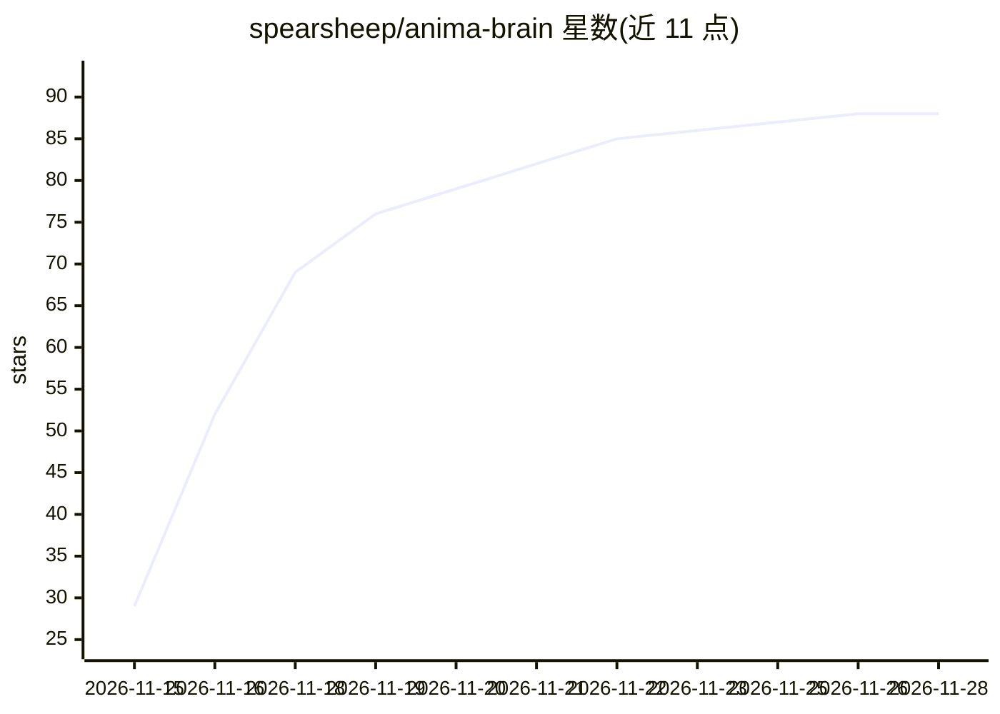

# spearsheep/anima-brain

⭐ 88 · HTML · MIT · 推送 2026-11-17 · [GitHub](https://github.com/spearsheep/anima-brain) · [官网](https://anima-lab.io) · 个人维护 · 中文 README

**给 AI 陪伴体提供本地记忆与情绪连续性的 Python SDK**

面向开发者的工具包，为 agent 构建持久记忆、角色身份与情绪连续性：本地 SQLite + FTS5 存储原始消息、带出处的事实、修正与情境笔记，提供本地词法检索与可选 embedding、引用式摘要，以及多模态（视觉、图像生成、语音与转录）和语音/动画视频通话适配。可经 Python SDK、MCP 接入 Claude Code 等宿主，自带模型（Bring your own model）。附带可选的 Companion Studio 本地 React 展示应用。Alpha 阶段，仅源码安装；情绪状态为虚构模拟，本地存储不等于本地推理，上下文会发送至所配置的提供商。

## 筛选速览

| 维度 | 判定 | 备注 |
|---|---|---|
| AI 角色 | `ai-ecosystem` | LLM/agent 周边工具 |
| 许可风险 | `permissive` | MIT |
| 部署形态 | `library` | 以包/库形式分发 |
| 模型依赖 | — | README 未给出锁定关系 |
| 硬件要求 | — | 无带数字的原话,不猜 |
| 安装摩擦 | `low` | 无编译、无系统依赖或容器化 |
| 成熟度 | `idea` | |

## 能力要点

- SQLite + FTS5 本地存储，无需 Anima 账户或 Convex 后端
- 有据记忆：原始证据、带源事实、修正与引用式摘要
- MCP 接入 Claude Code / Claude Desktop / DeepSeek Harness
- 可选语音通话（流式 ASR）与动画视频通话适配

## 适用场景

- 为自研 AI 陪伴/对话 agent 加装持久记忆与情绪连续性
- 通过 MCP 给 Claude Code 等宿主接入本地记忆工具
- 用本地 showcase 交互式调试记忆与上下文行为

## 场景标签

`Agent 记忆` · 领域:Agent 开发

## 证据(README 行号)

> L18: A developer toolkit for building agents with **persistent memory, character identity
> L19: and emotional continuity**. Use it from Python, plug it into an existing agent through
> L20: MCP, or connect your own frontend. Bring your own model. An optional

## 星数曲线

2026-11-15 29 → 2026-11-28 88（+59）

---
*卡片 v1 · prompt 1.4 · 生成 2026-11-18 · 置信度 high · 依据 README sha `5cc821cc7b39` · [字段定义](../../DATASET.md)*
