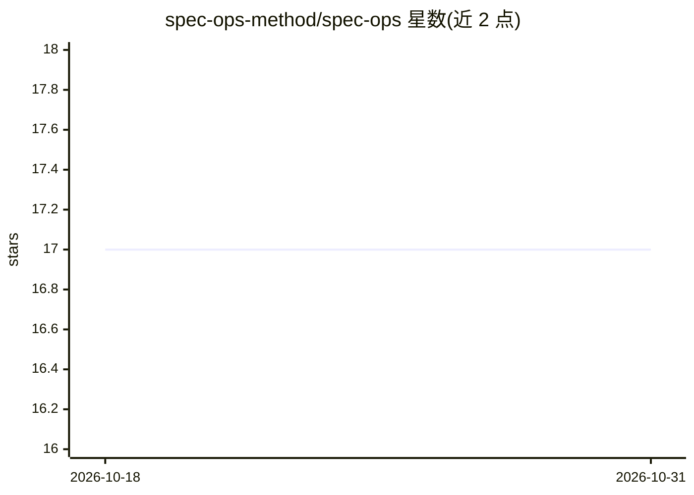

# spec-ops-method/spec-ops

⭐ 17 · JavaScript · MIT · 推送 2026-08-20 · [GitHub](https://github.com/spec-ops-method/spec-ops) · [官网](https://spec-ops.ai) · 组织维护

**面向政府遗留系统现代化的规范驱动方法论文档库**

SpecOps 是一套方法论与文档集合，主张用 AI 先将遗留系统（如 COBOL）的制度性知识编译为经领域专家人工核验的规范，再据规范生成新代码，而非直接转译代码。文档涵盖宣言、11 维度对比框架、核心工具、六阶段方法论（含 Strangler Fig 模式集成）、团队结构（8-18 人）与 AI agent 指令集示例；参考实现标注为开发中。面向政府机构与技术团队，MIT 许可，无安装代码，起步方式为阅读文档并小规模试点。

## 筛选速览

| 维度 | 判定 | 备注 |
|---|---|---|
| AI 角色 | `ai-knowledge` | 知识聚合/清单类 |
| 许可风险 | `permissive` | MIT |
| 部署形态 | `None` |  |
| 模型依赖 | — | README 未给出锁定关系 |
| 硬件要求 | — | 无带数字的原话,不猜 |
| 安装摩擦 | `low` | 无编译、无系统依赖或容器化 |
| 成熟度 | `idea` | |

## 能力要点

- 以规范为系统行为的权威事实源，变更先改规范再实现
- 六阶段方法论：发现、规范生成、核验、实现、测试、部署
- AI agent 指令集（技能）示例：COBOL 理解、规范生成等
- 基于 GitHub spec-kit 的规范驱动开发原则扩展

## 适用场景

- 政府遗留系统现代化前先保存领域专家的制度性知识
- 让领域专家用自然语言核验系统行为规范
- 按 Strangler Fig 模式分阶段增量替换遗留系统

## 场景标签

`教程课程` · 领域:学习与行业

## 证据(README 行号)

> L7: SpecOps is a methodology for using AI to modernize legacy government systems by focusing on knowledge `preservation 
> L59: ### 📋 Manifesto

## 星数曲线

2026-10-18 17 → 2026-10-31 17（+0）

---
*卡片 v1 · prompt 1.4 · 生成 2026-10-29 · 置信度 high · 依据 README sha `822edde2cac5` · [字段定义](../../DATASET.md)*
