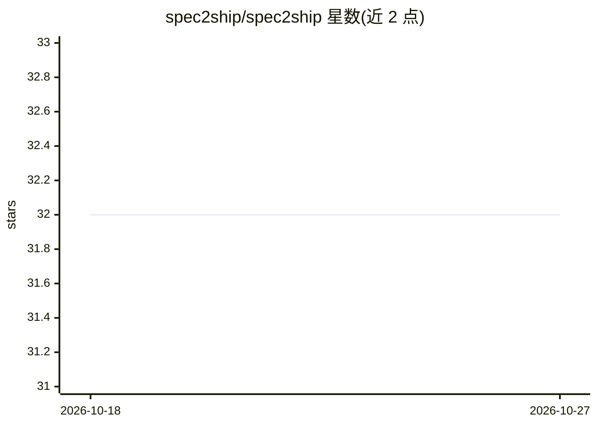

# spec2ship/spec2ship

⭐ 32 · Shell · MIT · 推送 2026-07-14 · [GitHub](https://github.com/spec2ship/spec2ship) · 组织维护

**Claude Code 插件：多 agent 圆桌讨论生成规格与设计**

构建于 Claude Code 之上的编排插件：以 12 个角色化 agent（产品经理、架构师、QA、安全等）组成圆桌讨论，围绕需求、架构与实现计划进行多轮辩论与收敛，产出 arc42、ISO 25010、MADR、STRIDE 等标准格式的结构化工件，会话含完整审计记录。提供 5 种主持策略（Standard/Disney/Debate/Consensus-Driven/Six Hats），支持自治与交互两种模式，低置信度或安全类关键词时触发人工升级。非独立 CLI，必须运行在 Claude Code 内，通过 /s2s: 命令调用，MIT 许可。

## 筛选速览

| 维度 | 判定 | 备注 |
|---|---|---|
| AI 角色 | `ai-ecosystem` | LLM/agent 周边工具 |
| 许可风险 | `permissive` | MIT |
| 部署形态 | `None` |  |
| 模型依赖 | locked-api |  |
| 硬件要求 | — | 无带数字的原话,不猜 |
| 安装摩擦 | `low` | 无编译、无系统依赖或容器化 |
| 成熟度 | — | 结构信号不足 |

## 能力要点

- 12 个专门化 agent 角色的圆桌讨论机制
- 产出 arc42/ISO 25010/MADR/STRIDE 标准格式工件
- 5 种可自动检测或显式指定的主持策略
- 低置信度、安全类关键词等升级触发器暂停等待人工输入

## 适用场景

- 在 Claude Code 中以多视角辩论方式产出可审计的需求与架构文档
- 对技术选型等争议性决策组织 Debate 式圆桌讨论
- 为团队交接保留带审计记录的结构化规格工件

## 场景标签

`多智能体` · 领域:Agent 开发

## 证据(README 行号)

> L10: Spec2Ship is a **Claude Code plugin** that adds structured orchestration for requirements, architecture, and implem
> L16: - An orchestration layer built on Claude Code primitives

## 星数曲线

2026-10-18 32 → 2026-10-27 32（+0）

---
*卡片 v1 · prompt 1.4 · 生成 2026-10-25 · 置信度 high · 依据 README sha `602d99f0bb1d` · [字段定义](../../DATASET.md)*
