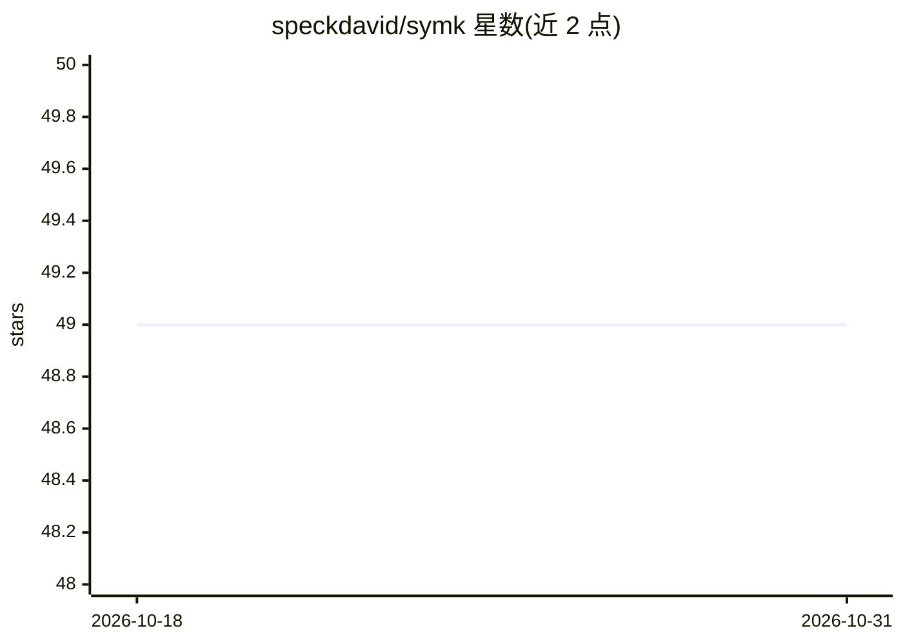

# speckdavid/symk

⭐ 49 · C · GPL-3.0 · 推送 2026-08-24 · [GitHub](https://github.com/speckdavid/symk) · 个人维护

**经典最优与 top-k 规划器：基于符号搜索求解 PDDL 任务**

扩展 Fast Downward 的经典规划器，采用符号搜索（双向/前向/后向），可输出单个最优计划或成本最低的 k 个不同计划（top-k/top-q），支持条件效果、带公理的派生谓词等 PDDL 特性，并可生成无环计划。提供可扩展的计划选择框架（如按动作多重集去重的 unordered selector）。安装途径包括 pip（作为 unified-planning 的 up-symk 包）、从源码编译及 Apptainer 容器镜像。主要在 Linux 开发测试，macOS 支持有限。

## 筛选速览

| 维度 | 判定 | 备注 |
|---|---|---|
| AI 角色 | `ai-native` | 本体是模型或模型工具 |
| 许可风险 | `viral` | GPL-3.0 |
| 部署形态 | `library` | 以包/库形式分发 |
| 模型依赖 | — | README 未给出锁定关系 |
| 硬件要求 | — | 无带数字的原话,不猜 |
| 安装摩擦 | `medium` | 含编译或系统依赖之一 |
| 成熟度 | — | 结构信号不足 |

## 能力要点

- 符号搜索输出最优计划或 top-k/top-q 多计划
- 原生支持条件效果与带公理的派生谓词
- 可定制的计划选择器框架与无环计划生成
- 作为 up-symk 包集成进 unified-planning，pip 可装

## 适用场景

- 求解 PDDL 领域/问题文件并获取最优行动计划
- 枚举同一任务的多个低成本计划做对比分析
- 在 unified-planning 框架中以 Python 调用规划器

## 场景标签

 · 领域:人工智能规划（经典规划）

## 证据(README 行号)

> L3: SymK is a state-of-the-art classical *optimal* and *top-k* planner based on symbolic search that extends [Fast
> L7: With SymK, it is possible to find a *single optimal plan* or a *set of k different best plans* with the lowest cost 

## 星数曲线

2026-10-18 49 → 2026-10-31 49（+0）

---
*卡片 v1 · prompt 1.4 · 生成 2026-10-25 · 置信度 high · 依据 README sha `9fffd3c04724` · [字段定义](../../DATASET.md)*
