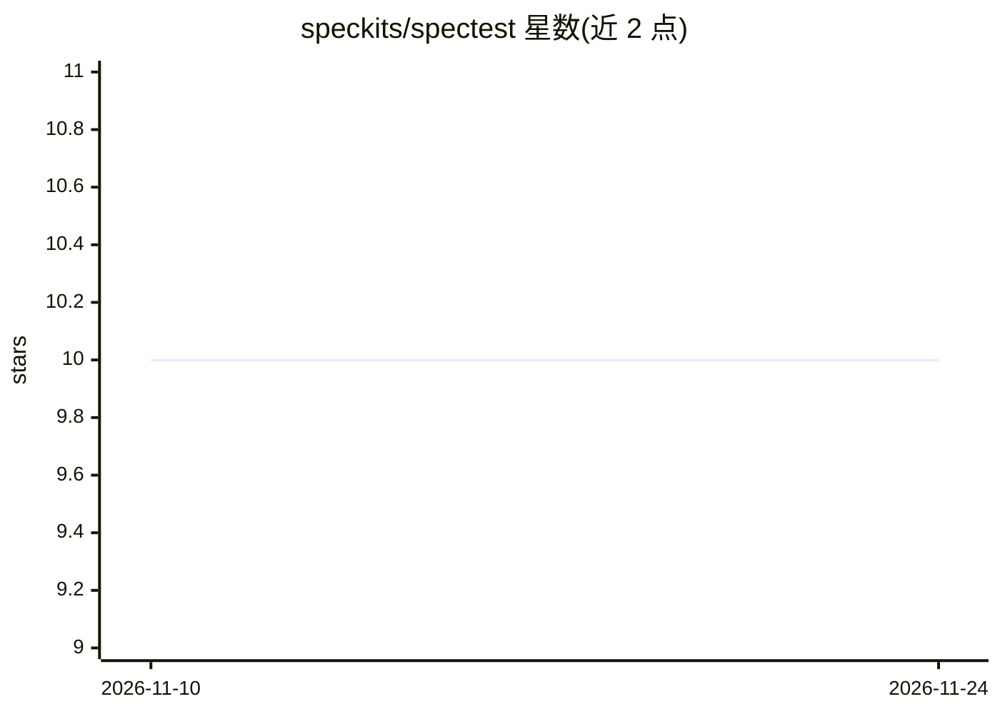

# speckits/spectest

⭐ 10 · TypeScript · MIT · 推送 2025-12-23 · [GitHub](https://github.com/speckits/spectest) · [官网](https://www.npmjs.com/package/@speckit/spectest) · 组织维护

**为 AI 编码助手提供规格驱动的自动化测试工作流 CLI**

OpenSpec 的分支，面向自动化测试场景：在写测试前先以规格（proposal、tasks、spec delta）锁定测试意图，提供测试规划、生成、修复（healing）、覆盖率分析四类专用工作流，重点适配 Playwright。通过为 20+ 种 AI 编码工具生成斜杠命令或 AGENTS.md 交接文件来接入现有助手，无需 API key。以 npm 全局 CLI 分发，命令包括 init/list/validate/show/archive。要求 Node.js >= 20.19.0。

## 筛选速览

| 维度 | 判定 | 备注 |
|---|---|---|
| AI 角色 | `ai-ecosystem` | LLM/agent 周边工具 |
| 许可风险 | `permissive` | MIT |
| 部署形态 | `library` | 以包/库形式分发 |
| 模型依赖 | — | README 未给出锁定关系 |
| 硬件要求 | — | 无带数字的原话,不猜 |
| 安装摩擦 | `low` | 无编译、无系统依赖或容器化 |
| 成熟度 | — | 结构信号不足 |

## 能力要点

- 测试规划、生成、修复、覆盖率分析四类专用工作流
- 支持 20+ AI 编码工具的原生斜杠命令与 AGENTS.md 兼容
- 无需 API key，specs 与 changes 目录分离管理测试差异
- 针对 Playwright 测试自动化的内置工作流与最佳实践

## 适用场景

- 用 AI 助手为登录页等功能生成 Playwright 测试
- 对现有测试套件做修复与覆盖率缺口分析
- 团队中以可审计的变更流程维护测试规格

## 场景标签

`浏览器自动化` `代码生成` · 领域:效率与自动化

## 证据(README 行号)

> L17: **SpecTest** is a specialized fork of OpenSpec, optimized for automation testing. It extends OpenSpec's spec-driven
> L60: - Works with the AI tools you already use: custom slash commands where supported, context rules everywhere else.
> L87: - **Test Planning**: AI explores your application under test and creates comprehensive test plans

## 星数曲线

2026-11-10 10 → 2026-11-24 10（+0）

---
*卡片 v1 · prompt 1.4 · 生成 2026-11-19 · 置信度 high · 依据 README sha `ecb32ac102b2` · [字段定义](../../DATASET.md)*
