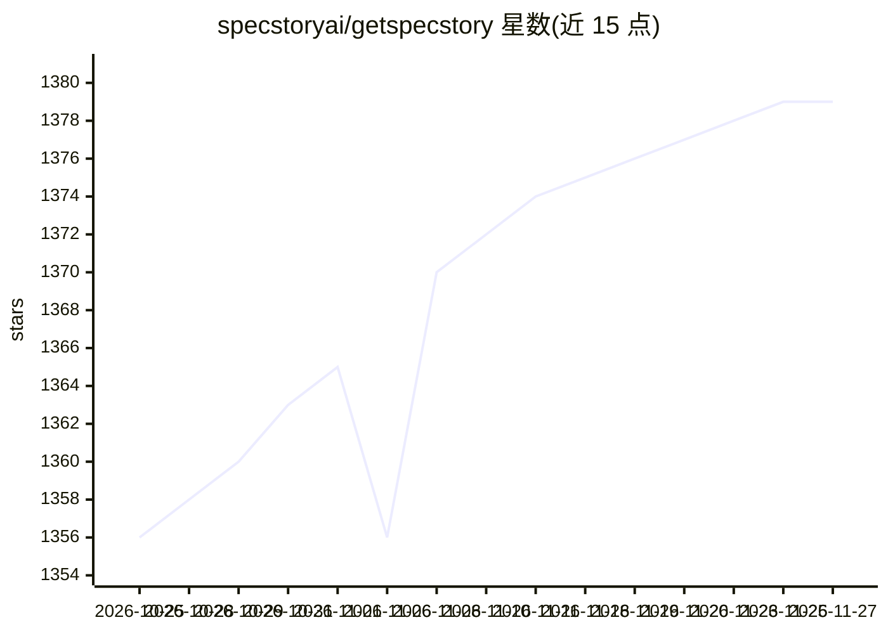

# specstoryai/getspecstory

⭐ 1,379 · Go · Apache-2.0 · 推送 2026-11-26 · [GitHub](https://github.com/specstoryai/getspecstory) · [官网](https://specstory.com/) · 组织维护

**为 AI 编程助手保存、检索并复用会话历史的工具**

SpecStory 通过 CLI（开源）与 IDE 扩展（闭源）将用户与各类 AI 编码代理的交互自动保存到项目内 .specstory/history/，默认本地存储，登录后可选同步到 SpecStory Cloud 进行全文检索、跨会话问答与团队共享。安装一个 CLI 包装器即可配合多种终端代理工作；Lore 功能可从历史会话中挖掘生成可复用的 agent 技能并安装到本地各代理。

## 筛选速览

| 维度 | 判定 | 备注 |
|---|---|---|
| AI 角色 | `ai-ecosystem` | LLM/agent 周边工具 |
| 许可风险 | `permissive` | Apache-2.0 |
| 部署形态 | `library` | 以包/库形式分发 |
| 模型依赖 | — | README 未给出锁定关系 |
| 硬件要求 | — | 无带数字的原话,不猜 |
| 安装摩擦 | `low` | 无编译、无系统依赖或容器化 |
| 成熟度 | — | 结构信号不足 |

## 能力要点

- 一次安装即可包装多种终端编码代理并自动保存会话
- 本地优先：不登录不向云端发送任何数据
- SpecStory Cloud 提供跨项目全文检索、会话问答与团队共享
- Lore 可将 .specstory/history 挖掘为带证据的 agent 技能

## 适用场景

- 保存并检索与 Claude Code、Codex 等代理的历史对话
- 团队间共享 AI 编程会话与解决方案
- 把常用工作流沉淀为可复用的 agent 技能
- 在多台电脑间恢复 AI 编码会话

## 场景标签

 · 领域:开发者工具/AI 编程辅助

## 证据(README 行号)

> L7: Never lose a brilliant solution, code snippet, or architectural decision again. SpecStory captures, indexes, and mak
> L35: 1. **Capture** - SpecStory CLI and IDE extensions save every AI interaction locally to `.specstory/history/`
> L45: SpecStory integrates seamlessly with your favorite AI coding tools, automatically saving all conversations locally 

## 星数曲线

2026-10-25 1,356 → 2026-11-27 1,379（+23）

---
*卡片 v1 · prompt 1.4 · 生成 2026-11-23 · 置信度 high · 依据 README sha `8301bf28b95a` · [字段定义](../../DATASET.md)*
