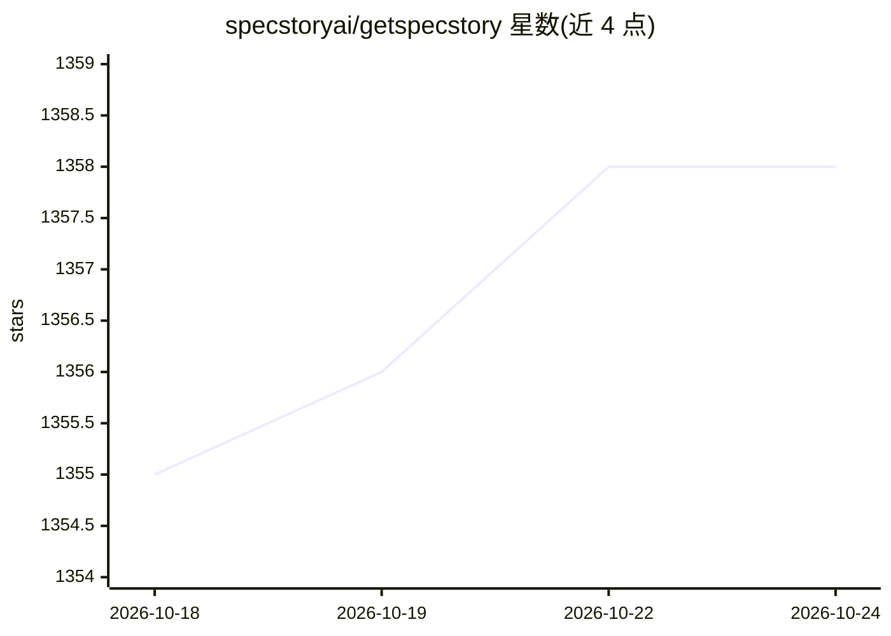

# specstoryai/getspecstory

⭐ 1,356 · Go · Apache-2.0 · 推送 2026-10-23 · [GitHub](https://github.com/specstoryai/getspecstory) · [官网](https://specstory.com/) · 组织维护

**为 AI 编程助手保存、检索会话并生成可复用技能的工具**

面向使用 AI 编程助手的开发者：通过 CLI 与 IDE 扩展（Cursor、VS Code Copilot）把与 Claude Code、Codex CLI、Gemini CLI 等十余种编程代理的会话自动保存到项目内 .specstory/history/，本地优先、默认不上传。可选登录后同步到 SpecStory Cloud，实现跨设备全文检索、对历史会话提问与团队共享。Lore 功能通过 /lore 从历史会话中挖掘证据并生成可安装的 agent 技能。CLI 开源，IDE 扩展闭源。

## 筛选速览

| 维度 | 判定 | 备注 |
|---|---|---|
| AI 角色 | `ai-ecosystem` | LLM/agent 周边工具 |
| 许可风险 | `permissive` | Apache-2.0 |
| 部署形态 | `library` | 以包/库形式分发 |
| 模型依赖 | — | README 未给出锁定关系 |
| 硬件要求 | — | 无带数字的原话,不猜 |
| 安装摩擦 | `low` | 无编译、无系统依赖或容器化 |
| 成熟度 | — | 结构信号不足 |

## 能力要点

- 支持 15 种 AI 编程工具的会话本地自动保存（CLI 与 IDE 扩展）
- Lore 从 .specstory/history/ 挖掘生成基于证据的 agent 技能（npx skills add 安装）
- 可选 SpecStory Cloud 同步：跨设备全文检索、历史问答、团队共享、API 访问
- 本地优先，未登录不上传任何数据

## 适用场景

- 我在多个项目和多种 AI 编程代理间找回过去的关键决策与代码方案
- 我想跨设备或团队共享 AI 编程会话知识
- 我想把日常工作流沉淀为可复用的 agent 技能

## 场景标签

`知识库管理` `Agent 记忆` · 领域:Agent 开发

## 证据(README 行号)

> L35: 1. **Capture** - SpecStory CLI and IDE extensions save every AI interaction locally to `.specstory/history/`
> L49: |Supported Agent|Agent Type|Min Version|SpecStory Product|Source Code|Installation|

## 星数曲线

2026-10-18 1,355 → 2026-10-24 1,358（+3）

---
*卡片 v1 · prompt 1.4 · 生成 2026-10-21 · 置信度 high · 依据 README sha `300f1dd547b6` · [字段定义](../../DATASET.md)*
