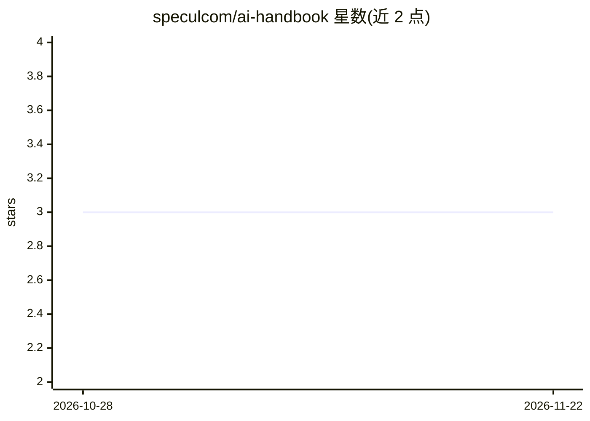

# speculcom/ai-handbook

⭐ 3 · HTML · 推送 2026-11-21 · [GitHub](https://github.com/speculcom/ai-handbook) · [官网](https://learn.specul.com) · 个人维护 · 中文 README

**学AI、AI工具、AI模型的中文手册内容源**

specul.com 站群三个内容栏目（learn / tools / models）的合并内容仓：terms 子树收录 292 个词条与 16 条学习路径，tools 子树收录 280 份 AI 工具档案并按 8 个固定维度对比，models 子树整理 16 个模型仓、129 个量化仓与 1337 个 GGUF 文件的选型数据。三子树共用 shared/ 品牌外壳，各带校验器，Node 脚本构建为静态站点；纪律包括每条判断挂官方源、不给总分排名、只索引不托管权重。

## 筛选速览

| 维度 | 判定 | 备注 |
|---|---|---|
| AI 角色 | `ai-knowledge` | 知识聚合/清单类 |
| 许可风险 | `none` | — |
| 部署形态 | `None` |  |
| 模型依赖 | — | README 未给出锁定关系 |
| 硬件要求 | — | 无带数字的原话,不猜 |
| 安装摩擦 | `low` | 无编译、无系统依赖或容器化 |
| 成熟度 | — | 结构信号不足 |

## 能力要点

- 三个子树分别覆盖术语学习、工具选型、模型量化版选择
- 280 份工具档案按 8 个固定维度横向对比
- models 子树整理 1337 个 GGUF 文件与 54 位量化者数据
- 每条判断附官方出处，823 条出处条目

## 适用场景

- 中文使用者系统学习 AI 术语与概念
- 在多个 AI 工具/agent 之间做选型对比
- 面对同一模型的几十个量化版本时决定下载哪个

## 场景标签

`教程课程` · 领域:学习与行业

## 证据(README 行号)

> L5: 一本手册，三部分：**学 AI · 用 AI 工具 · 跑 AI 模型**。中文为主、中英双语，每条判断带官方出处。
> L13: |`terms/`|这些名词是什么、为什么要知道它？|learn.specul.com|
> L50: |tools · 档案总数|280 份|

## 星数曲线

2026-10-28 3 → 2026-11-22 3（+0）

---
*卡片 v1 · prompt 1.4 · 生成 2026-11-21 · 置信度 high · 依据 README sha `6336aed7a0f9` · [字段定义](../../DATASET.md)*
