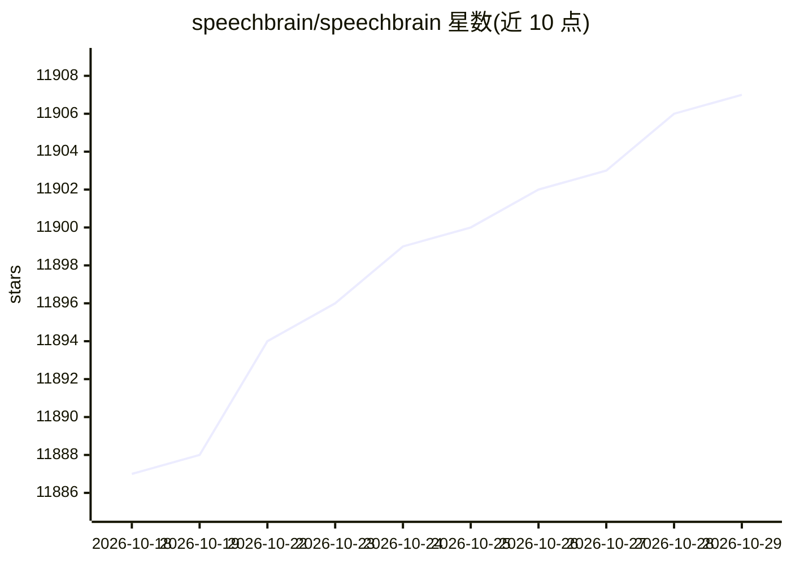

# speechbrain/speechbrain

⭐ 11,907 · Python · Apache-2.0 · 推送 2026-10-14 · [GitHub](https://github.com/speechbrain/speechbrain) · [官网](http://speechbrain.github.io) · 组织维护

**面向对话式 AI 的 PyTorch 语音/文本工具包**

基于 PyTorch 的开源工具包，用于构建语音与文本处理系统：提供 200 余个训练配方（覆盖 40+ 数据集、20 类任务，含语音识别、说话人识别、语音分离/增强、TTS、语言建模、EEG 等）、100 余个 HuggingFace 托管的预训练模型及其推理接口。支持 Whisper/Wav2Vec2/Llama2 等预训练模型的微调，提供 YAML 超参管理、Brain 类训练编排、多 GPU 分布式训练、动态批处理与混合精度。面向科研与工业研发，被多所院校用于教学。Apache-2.0 许可。

## 筛选速览

| 维度 | 判定 | 备注 |
|---|---|---|
| AI 角色 | `ai-ecosystem` | LLM/agent 周边工具 |
| 许可风险 | `permissive` | Apache-2.0 |
| 部署形态 | `library` | 以包/库形式分发 |
| 模型依赖 | — | README 未给出锁定关系 |
| 硬件要求 | — | 无带数字的原话,不猜 |
| 安装摩擦 | `low` | 无编译、无系统依赖或容器化 |
| 成熟度 | — | 结构信号不足 |

## 能力要点

- 200+ 训练配方覆盖 40+ 数据集、20 类语音/文本任务
- 100+ HuggingFace 预训练模型，三行代码即可转录语音
- 支持单机/多机多 GPU 训练、混合精度与动态批处理
- 支持 Whisper/Wav2Vec2/WavLM/Hubert/GPT2/Llama2 微调

## 适用场景

- 复现或改进语音识别、说话人识别等任务的基线模型
- 用预训练模型快速做语音转录/说话人验证的原型
- 作为课程教学材料学习对话式 AI 技术

## 场景标签

`语音识别` `语音合成` `微调` `科研工具` · 领域:内容生成

## 证据(README 行号)

> L13: - SpeechBrain is an **open-source** PyTorch toolkit that accelerates **Conversational AI** development, i.e., the t
> L26: ## 📚 Training Recipes
> L137: - SpeechBrain is a versatile framework designed for implementing a wide range of technologies within the field of 

## 星数曲线

2026-10-18 11,887 → 2026-10-29 11,907（+20）

---
*卡片 v1 · prompt 1.4 · 生成 2026-10-20 · 置信度 high · 依据 README sha `f390df6c1d83` · [字段定义](../../DATASET.md)*
