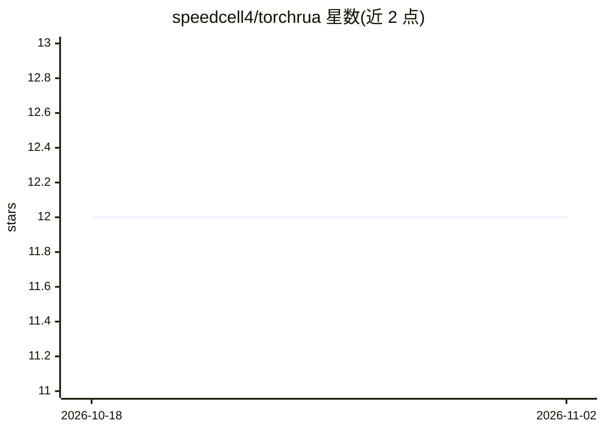

# speedcell4/torchrua

⭐ 12 · Python · MIT · 推送 2026-01-04 · [GitHub](https://github.com/speedcell4/torchrua) · 个人维护 · 中文 README

**PyTorch 张量操作库：处理 Packed/Catted/Padded 变长序列**

TorchRua 是一个基于 PyTorch 的张量操作工具库，围绕变长序列的三种表示（PackedSequence、CattedSequence、PaddedSequence）提供相互转换与操作函数，便于处理不等长数据。库名取自四川话'挼'（ruá），意为摆弄、揉搓张量。以 Python 包形式通过 pip 安装，面向使用 PyTorch 构建深度学习模型的开发者。README 较简短，未说明具体函数清单与性能特征。

## 筛选速览

| 维度 | 判定 | 备注 |
|---|---|---|
| AI 角色 | `ai-ecosystem` | LLM/agent 周边工具 |
| 许可风险 | `permissive` | MIT |
| 部署形态 | `library` | 以包/库形式分发 |
| 模型依赖 | — | README 未给出锁定关系 |
| 硬件要求 | — | 无带数字的原话,不猜 |
| 安装摩擦 | `low` | 无编译、无系统依赖或容器化 |
| 成熟度 | — | 结构信号不足 |

## 能力要点

- 支持 PackedSequence、CattedSequence、PaddedSequence 三种变长序列表示
- 提供多种易用的张量操作与转换函数
- 以 pip 包分发，含 CI（GitHub Workflow）

## 适用场景

- 在 PyTorch 中处理不等长序列（如 NLP 变长句子）的转换与操作
- 在不同变长张量表示之间做相互转换
- 批处理变长数据时替代手写 padding/packing 逻辑

## 场景标签

 · 领域:深度学习/工具库

## 证据(README 行号)

> L8: ruá</rt></ruby> which means "pack, rumple, screw up, manipulate". TorchRua provides tons of easy-to-use functions to
> L9: help you rua tensors with `PackedSequence`, `CattedSequence`, and `PaddedSequence`!

## 星数曲线

2026-10-18 12 → 2026-11-02 12（+0）

---
*卡片 v1 · prompt 1.4 · 生成 2026-11-01 · 置信度 mid · 依据 README sha `1c18b8a4fd42` · [字段定义](../../DATASET.md)*
