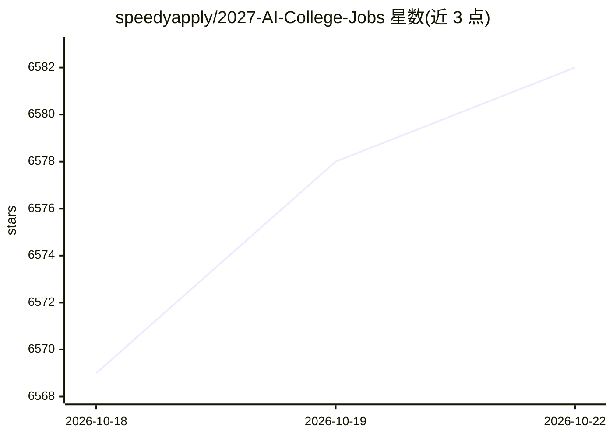

# speedyapply/2027-AI-College-Jobs

⭐ 6,582 · 推送 2026-10-20 · [GitHub](https://github.com/speedyapply/2027-AI-College-Jobs) · [官网](https://speedyapply.com/discord) · 组织维护

**面向大学生的 2027 届 AI/ML 实习与新毕业生职位清单**

由 SpeedyApply 维护的 AI/ML 与数据科学职位聚合清单，面向寻找实习或新毕业生岗位的大学生，按美国与国际、实习与新毕业生分区，再按 FAANG+、量化等类别组织。职位每日更新，优先收录近 120 天内发布的岗位，每条列出公司、职位、地点、时薪、发布时长并附申请链接。仓库同时链接 SpeedyApply 网站、Discord 社区与 Chrome 浏览器扩展。可见部分为 2027 美国 AI 实习 FAANG+ 类别表格（Meta、TikTok、NVIDIA 等约百条）。

## 筛选速览

| 维度 | 判定 | 备注 |
|---|---|---|
| AI 角色 | `ai-knowledge` | 知识聚合/清单类 |
| 许可风险 | `none` | — |
| 部署形态 | `None` |  |
| 模型依赖 | — | README 未给出锁定关系 |
| 硬件要求 | — | 无带数字的原话,不猜 |
| 安装摩擦 | `low` | 无编译、无系统依赖或容器化 |
| 成熟度 | — | 结构信号不足 |

## 能力要点

- 按美国/国际 × 实习/新毕业生四分区组织职位
- 职位每日更新，优先收录近 120 天内发布的岗位
- 每条职位含公司、地点、时薪、发布时长与申请链接
- 关联 SpeedyApply Chrome 扩展与 Discord 社区

## 适用场景

- 找 2027 届 AI/ML 实习或新毕业生岗位
- 对比 FAANG+、量化等不同类别公司的薪资与地点
- 了解近期（120 天内）发布的 AI 职位动态

## 场景标签

`精选清单` · 领域:学习与行业

## 证据(README 行号)

> L1: # 2027 Artificial Intelligence Internship & New Grad Positions
> L3: This repository is a comprehensive list of AI/ML & Data Science jobs for college students in search of **internships

## 星数曲线

2026-10-18 6,569 → 2026-10-22 6,582（+13）

---
*卡片 v1 · prompt 1.4 · 生成 2026-10-20 · 置信度 high · 依据 README sha `3df87f279e99` · [字段定义](../../DATASET.md)*
