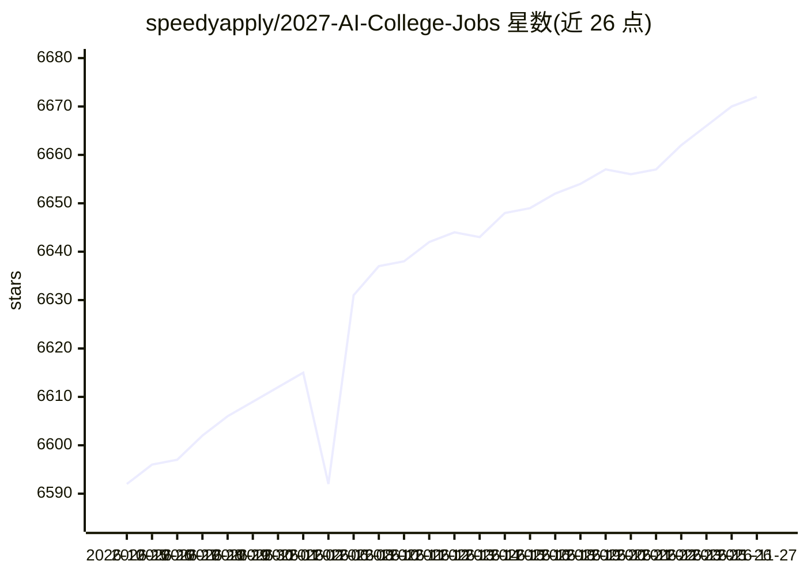

# speedyapply/2027-AI-College-Jobs

⭐ 6,672 · 推送 2026-11-26 · [GitHub](https://github.com/speedyapply/2027-AI-College-Jobs) · [官网](https://speedyapply.com/discord) · 组织维护

**面向大学生的 AI/ML 实习与应届岗位每日更新清单**

该仓库维护一份面向在校学生的 AI/ML 与数据科学职位清单，按美国与国际、实习与应届生分类列出职位，条目包含公司、职位、地点、薪资、申请链接与发布天数，每日更新并保留最近 120 天内发布的岗位。README 另链接到 SpeedyApply 网站、Discord 社区、Chrome 扩展商店页面，以及一份独立的软件工程岗位清单。

## 筛选速览

| 维度 | 判定 | 备注 |
|---|---|---|
| AI 角色 | `ai-knowledge` | 知识聚合/清单类 |
| 许可风险 | `none` | — |
| 部署形态 | `None` |  |
| 模型依赖 | — | README 未给出锁定关系 |
| 硬件要求 | — | 无带数字的原话,不猜 |
| 安装摩擦 | `low` | 无编译、无系统依赖或容器化 |
| 成熟度 | — | 结构信号不足 |

## 能力要点

- 美国实习 946 个、应届 642 个；国际实习 743 个、应届 826 个（README 计数）
- 职位每日更新，优先展示近 120 天内发布的岗位
- 条目含公司、地点、薪资、申请链接与发布年龄
- 另提供 SWE 大学生岗位清单与 Discord 社区入口

## 适用场景

- 找 AI/ML 实习岗位并直接跳转申请链接
- 应届生检索国际与美国的 AI 新毕业生职位
- 按发布时间关注近期新放出的岗位

## 场景标签

 · 领域:求职/招聘信息聚合

## 证据(README 行号)

> L3: This repository is a comprehensive list of AI/ML & Data Science jobs for college students in search of **internships
> L26: ## 2027 USA AI Internships :books::eagle:
> L32: |Company|Position|Location|Salary|Posting|Age|

## 星数曲线

2026-10-25 6,592 → 2026-11-27 6,672（+80）

---
*卡片 v1 · prompt 1.4 · 生成 2026-11-27 · 置信度 high · 依据 README sha `636b7df2c67c` · [字段定义](../../DATASET.md)*
