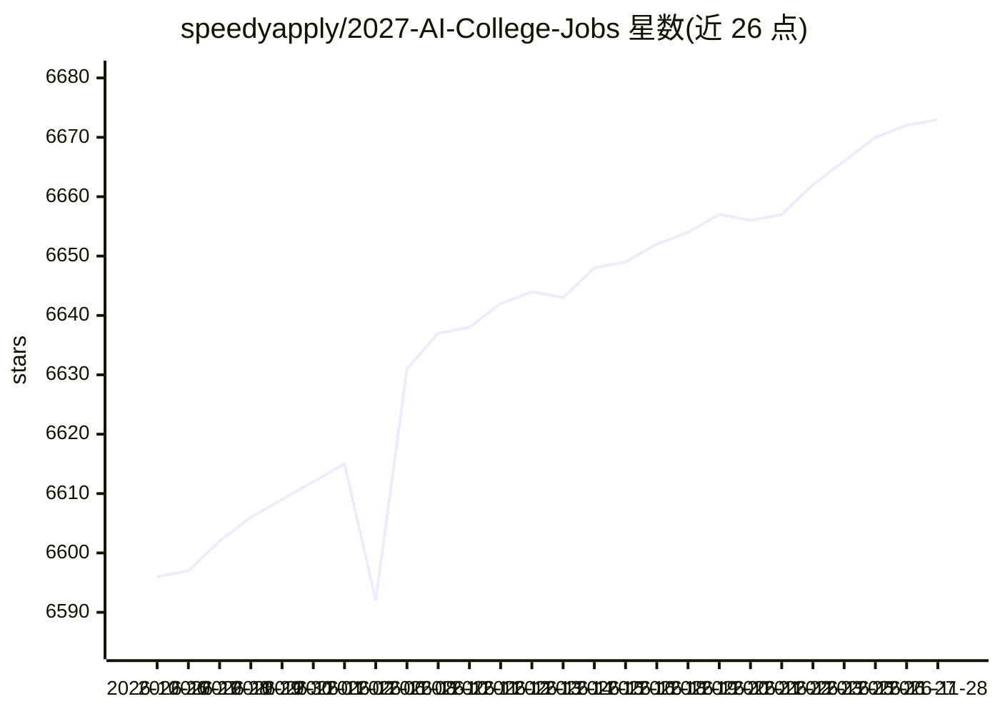

# speedyapply/2027-AI-College-Jobs

⭐ 6,673 · 推送 2026-11-27 · [GitHub](https://github.com/speedyapply/2027-AI-College-Jobs) · [官网](https://speedyapply.com/discord) · 组织维护

**面向大学生的 AI/ML 实习与应届岗位每日更新清单**

面向寻找实习或应届职位的在校学生，收录 AI/ML 与数据科学岗位列表，每日更新并优先保留 120 天内发布的职位。按美国与国际职位、实习与应届两类组织，标注公司、职位、地点、薪资与发布时长，分为 FAANG+、Quant、Other 等分组；另提供关联的 SWE 岗位清单、网站与 Discord 社区入口。

## 筛选速览

| 维度 | 判定 | 备注 |
|---|---|---|
| AI 角色 | `ai-knowledge` | 知识聚合/清单类 |
| 许可风险 | `none` | — |
| 部署形态 | `None` |  |
| 模型依赖 | — | README 未给出锁定关系 |
| 硬件要求 | — | 无带数字的原话,不猜 |
| 安装摩擦 | `low` | 无编译、无系统依赖或容器化 |
| 成熟度 | — | 结构信号不足 |

## 能力要点

- 每日更新，优先保留 120 天内发布的职位
- 覆盖美国 953 个实习、648 个应届及国际岗位
- 按 FAANG+/Quant/Other 分组并列出薪资与发布时长

## 适用场景

- 查找 AI/ML 领域的实习岗位
- 查找新毕业可申请的全职岗位
- 跟踪 FAANG、Quant 等公司的 AI 招聘动态

## 场景标签

`精选清单` · 领域:学习与行业

## 证据(README 行号)

> L1: # 2027 Artificial Intelligence Internship & New Grad Positions
> L3: This repository is a comprehensive list of AI/ML & Data Science jobs for college students in search of **internships
> L26: ## 2027 USA AI Internships :books::eagle:

## 星数曲线

2026-10-26 6,596 → 2026-11-28 6,673（+77）

---
*卡片 v1 · prompt 1.4 · 生成 2026-11-28 · 置信度 high · 依据 README sha `732f439bd01f` · [字段定义](../../DATASET.md)*
