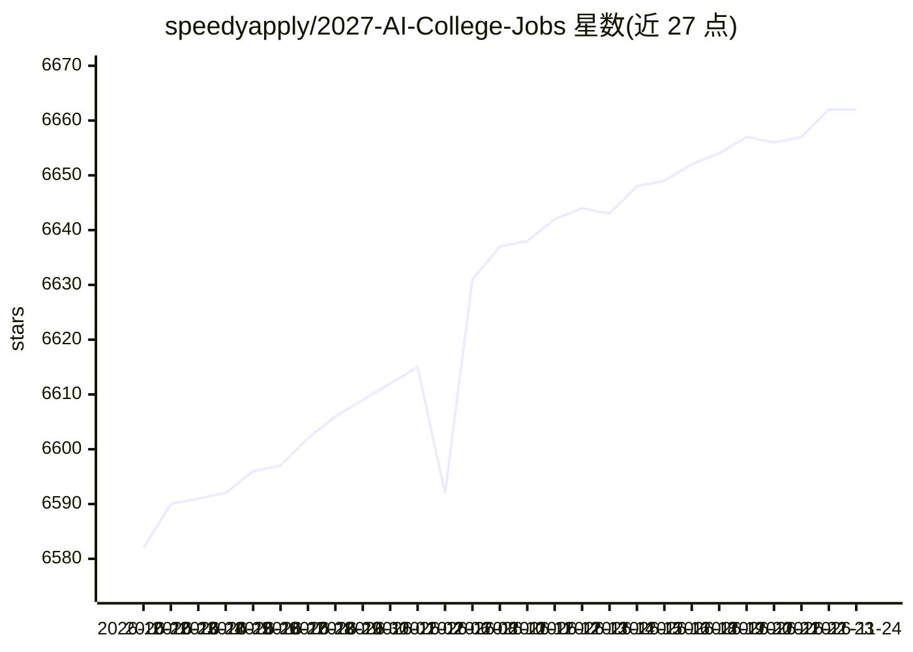

# speedyapply/2027-AI-College-Jobs

⭐ 6,662 · 推送 2026-11-22 · [GitHub](https://github.com/speedyapply/2027-AI-College-Jobs) · [官网](https://speedyapply.com/discord) · 组织维护

**面向大学生的 AI/ML 实习与应届岗位每日更新清单**

汇总 AI/ML 与数据科学方向的大学生岗位信息：覆盖美国与国际地区的实习及应届职位，按 FAANG+、量化、其他分类组织成表格，含公司、职位、地点、薪资、申请链接与发布天数，每天更新并优先保留 120 天内发布的岗位。README 另提供关联的 SWE 岗位清单、SpeedyApply 网站、Discord 社区与 Chrome 浏览器插件链接。

## 筛选速览

| 维度 | 判定 | 备注 |
|---|---|---|
| AI 角色 | `ai-knowledge` | 知识聚合/清单类 |
| 许可风险 | `none` | — |
| 部署形态 | `None` |  |
| 模型依赖 | — | README 未给出锁定关系 |
| 硬件要求 | — | 无带数字的原话,不猜 |
| 安装摩擦 | `low` | 无编译、无系统依赖或容器化 |
| 成熟度 | — | 结构信号不足 |

## 能力要点

- 每日更新，优先保留 120 天内发布的岗位
- 美国 956 条实习、640 条应届岗位，国际岗位另计
- 按 FAANG+/Quant/其他分类，表格含薪资与发布天数

## 适用场景

- 查找 AI/ML 方向的实习岗位投递
- 查找应届毕业生全职岗位
- 跟踪大厂 AI 岗位的薪资与开放状态

## 场景标签

`精选清单` · 领域:学习与行业

## 证据(README 行号)

> L3: This repository is a comprehensive list of AI/ML & Data Science jobs for college students in search of **internships
> L6: - Internships :books: - **956** available (FAANG+, Quant, Other)

## 星数曲线

2026-10-22 6,582 → 2026-11-24 6,662（+80）

---
*卡片 v1 · prompt 1.4 · 生成 2026-11-23 · 置信度 high · 依据 README sha `4c8e59b50219` · [字段定义](../../DATASET.md)*
