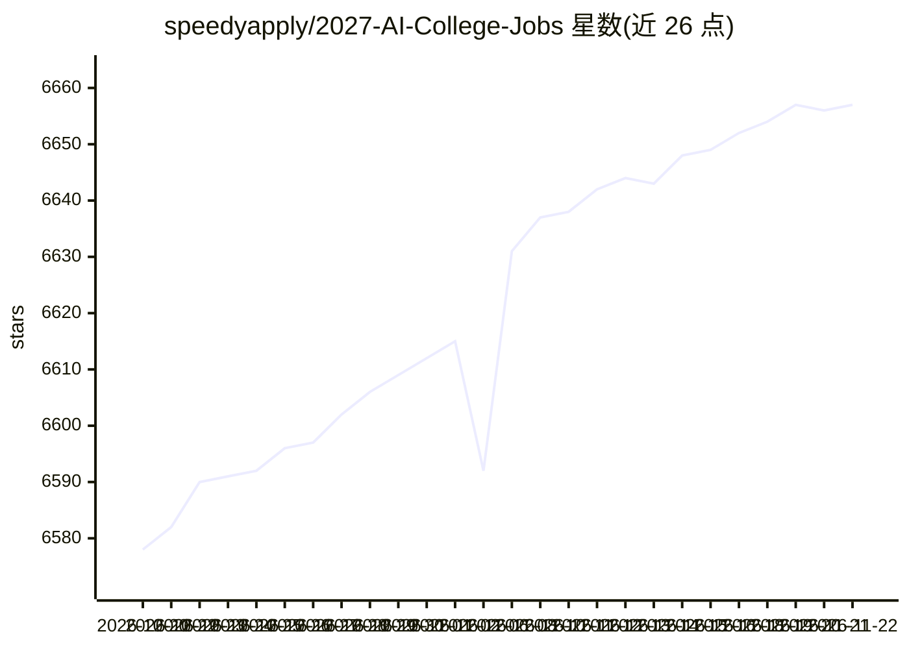

# speedyapply/2027-AI-College-Jobs

⭐ 6,657 · 推送 2026-11-21 · [GitHub](https://github.com/speedyapply/2027-AI-College-Jobs) · [官网](https://speedyapply.com/discord) · 组织维护

**面向大学生的 AI/ML 实习与应届岗位每日更新清单**

收录面向大学生的 AI/ML 与数据科学职位清单，按美国与国际、实习与应届生四个板块组织，包含 FAANG+、量化及其他公司职位，标注职位、地点、薪资、申请链接与发布天数，每日更新且只保留 120 天内发布的职位。另提供关联的软件工程职位清单、Discord 社区与 SpeedyApply Chrome 扩展链接。

## 筛选速览

| 维度 | 判定 | 备注 |
|---|---|---|
| AI 角色 | `ai-knowledge` | 知识聚合/清单类 |
| 许可风险 | `none` | — |
| 部署形态 | `None` |  |
| 模型依赖 | — | README 未给出锁定关系 |
| 硬件要求 | — | 无带数字的原话,不猜 |
| 安装摩擦 | `low` | 无编译、无系统依赖或容器化 |
| 成熟度 | — | 结构信号不足 |

## 能力要点

- 每日更新，仅收录 120 天内发布的职位
- 按美国/国际 × 实习/应届生四个板块组织
- 条目含公司、职位、地点、薪资与发布时长

## 适用场景

- 查找 AI/ML 方向的实习或应届生岗位
- 跟踪 FAANG 与量化公司的最新招聘信息
- 求职季了解岗位薪资与发布时效

## 场景标签

`精选清单` · 领域:学习与行业

## 证据(README 行号)

> L1: # 2027 Artificial Intelligence Internship & New Grad Positions
> L3: This repository is a comprehensive list of AI/ML & Data Science jobs for college students in search of **internships
> L6: - Internships :books: - **945** available (FAANG+, Quant, Other)

## 星数曲线

2026-10-20 6,578 → 2026-11-22 6,657（+79）

---
*卡片 v1 · prompt 1.4 · 生成 2026-11-22 · 置信度 high · 依据 README sha `4582bf356fa6` · [字段定义](../../DATASET.md)*
