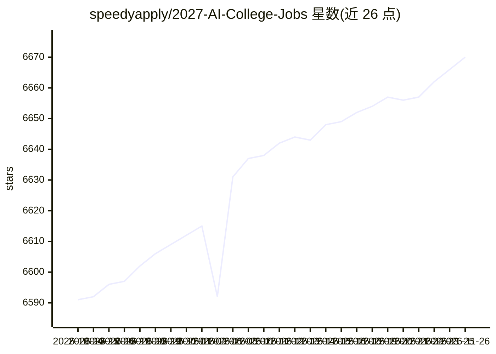

# speedyapply/2027-AI-College-Jobs

⭐ 6,670 · 推送 2026-11-25 · [GitHub](https://github.com/speedyapply/2027-AI-College-Jobs) · [官网](https://speedyapply.com/discord) · 组织维护

**面向大学生的 AI/ML 实习与校招职位每日更新清单**

汇总面向在校学生的 AI/ML 与数据科学实习及应届生职位清单，按美国与国际职位、实习与新毕业生类别分组，并在每组下再按 FAANG+、Quant、Other 分类；职位每日更新，优先收录 120 天内发布的岗位，条目含公司、职位、地点、薪资、申请链接与发布天数。维护方同时提供 job market 网站、Discord 服务器、Chrome 扩展及独立的软件工程职位清单。

## 筛选速览

| 维度 | 判定 | 备注 |
|---|---|---|
| AI 角色 | `ai-knowledge` | 知识聚合/清单类 |
| 许可风险 | `none` | — |
| 部署形态 | `None` |  |
| 模型依赖 | — | README 未给出锁定关系 |
| 硬件要求 | — | 无带数字的原话,不猜 |
| 安装摩擦 | `low` | 无编译、无系统依赖或容器化 |
| 成熟度 | — | 结构信号不足 |

## 能力要点

- 职位每日更新，优先收录 120 天内发布的岗位
- 按美国/国际与实习/新毕业生分类组织条目
- 条目含公司、职位、地点、薪资与申请链接
- 另提供配套 Chrome 扩展与 Discord 服务器

## 适用场景

- 查找 AI/ML 方向的暑期实习岗位
- 浏览 FAANG 与量化公司对应届生的招聘职位
- 跟踪近 120 天内新发布的校招信息

## 场景标签

 · 领域:求职/招聘信息聚合

## 证据(README 行号)

> L1: # 2027 Artificial Intelligence Internship & New Grad Positions
> L3: This repository is a comprehensive list of AI/ML & Data Science jobs for college students in search of **internships

## 星数曲线

2026-10-24 6,591 → 2026-11-26 6,670（+79）

---
*卡片 v1 · prompt 1.4 · 生成 2026-11-24 · 置信度 high · 依据 README sha `dd399fd8c46d` · [字段定义](../../DATASET.md)*
