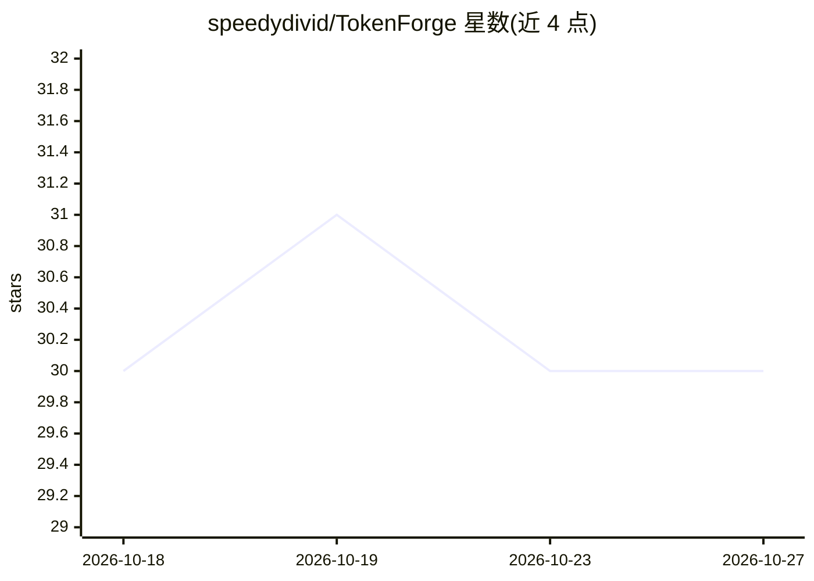

# speedydivid/TokenForge

⭐ 30 · JavaScript · 推送 2026-10-17 · [GitHub](https://github.com/speedydivid/TokenForge) · 个人维护

**优化 AI 编程代理上下文的开源引擎：压缩工具输出并持久化会话记忆**

面向使用 Claude Code、Gemini CLI、VS Code Copilot、OpenCode、Codex CLI 等 AI 编程代理的开发者的上下文优化引擎。通过 hooks 与 MCP 集成拦截工具交互，在输出到达代理前过滤或压缩（支持的工作流中称最高减少 98%），将有用会话信息存入本地 SQLite 并以 FTS5 全文检索召回，支持跨 17 个平台进行工具路由。README 未给出具体安装命令，仅显示 Download Now 链接。

## 筛选速览

| 维度 | 判定 | 备注 |
|---|---|---|
| AI 角色 | `ai-ecosystem` | LLM/agent 周边工具 |
| 许可风险 | `none` | — |
| 部署形态 | `None` |  |
| 模型依赖 | — | README 未给出锁定关系 |
| 硬件要求 | — | 无带数字的原话,不猜 |
| 安装摩擦 | `low` | 无编译、无系统依赖或容器化 |
| 成熟度 | — | 结构信号不足 |

## 能力要点

- 通过 hooks 与 MCP 拦截并压缩工具输出（支持工作流中称最高减少 98%）
- SQLite + FTS5 存储与检索持久化会话记忆
- 跨 17 个支持平台进行工具路由
- 兼容 5 种 AI 编程代理环境

## 适用场景

- 减少 Claude Code / Gemini CLI 等代理会话中的 token 消耗
- 跨会话保留项目记忆，避免重复解释
- 压缩冗长工具输出保持编码会话聚焦

## 场景标签

`Agent 记忆` · 领域:Agent 开发

## 证据(README 行号)

> L5: TokenForge is an open-source context optimization engine designed to reduce token consumption, preserve session memo
> L18: - **MCP Integration** — connect AI coding agents through the Model Context Protocol.
> L36: 1. Intercepts supported tool interactions through hooks and MCP integrations.

## 星数曲线

2026-10-18 30 → 2026-10-27 30（+0）

---
*卡片 v1 · prompt 1.4 · 生成 2026-10-26 · 置信度 high · 依据 README sha `47b4a800f0ca` · [字段定义](../../DATASET.md)*
