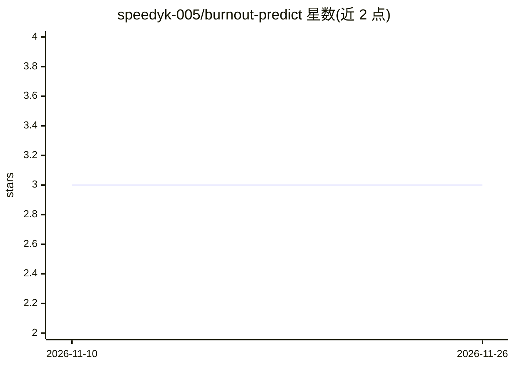

# speedyk-005/burnout-predict

⭐ 3 · Jupyter Notebook · BSD-3-Clause · 推送 2026-11-16 · [GitHub](https://github.com/speedyk-005/burnout-predict) · [官网](https://burnout-predict-1944.onrender.com/docs) · 个人维护

**从学业与生活调查数据预测学生倦怠风险的分类微服务**

面向高校场景的二分类 API：读取包含学业负担、睡眠、屏幕时间、家庭支持等 14 个字段的学生调查 JSON，经 DictVectorizer 与 XGBClassifier 组成的 scikit-learn 管线输出 at_risk 布尔值与概率。训练数据来自 Mendeley 的大学生压力数据集，阈值调至 0.47，ROC AUC 0.897。提供本地运行、Docker 镜像与 Render 免费版部署路径，供学业辅导仪表盘或健康类应用集成。

## 筛选速览

| 维度 | 判定 | 备注 |
|---|---|---|
| AI 角色 | `ai-native` | 本体是模型或模型工具 |
| 许可风险 | `permissive` | BSD-3-Clause |
| 部署形态 | `self-host` | docker 或自建部署 |
| 模型依赖 | — | README 未给出锁定关系 |
| 硬件要求 | — | 无带数字的原话,不猜 |
| 安装摩擦 | `low` | 无编译、无系统依赖或容器化 |
| 成熟度 | — | 结构信号不足 |

## 能力要点

- DictVectorizer + XGBClassifier 单一管线，推理接受纯字典输入
- POST /predict 返回 at_risk 与概率，支持 NDJSON 流式输出
- 决策阈值 0.47 由扫描调优，ROC AUC 0.897
- 提供 Dockerfile 与 Render 部署步骤，模型与特征结构已打包进镜像

## 适用场景

- 在学业辅导系统中按周期问卷自动标记需关注的学生
- 为健康类应用提供工作休息比例预警的打分接口
- 本地训练并复现端到端的学生压力分类实验

## 场景标签

 · 领域:教育/机器学习服务

## 证据(README 行号)

> L15: `burnout-predict` addresses this by providing a deployable end-to-end classification pipeline.
> L30: **Task.** Binary classification: predict `at_risk`, meaning a student is trending toward burnout. The survey record
> L38: **Model.** `DictVectorizer` + `XGBClassifier` in a single scikit-learn `Pipeline`, so the vectorizer's feature sche

## 星数曲线

2026-11-10 3 → 2026-11-26 3（+0）

---
*卡片 v1 · prompt 1.4 · 生成 2026-11-21 · 置信度 high · 依据 README sha `5de8543ac061` · [字段定义](../../DATASET.md)*
