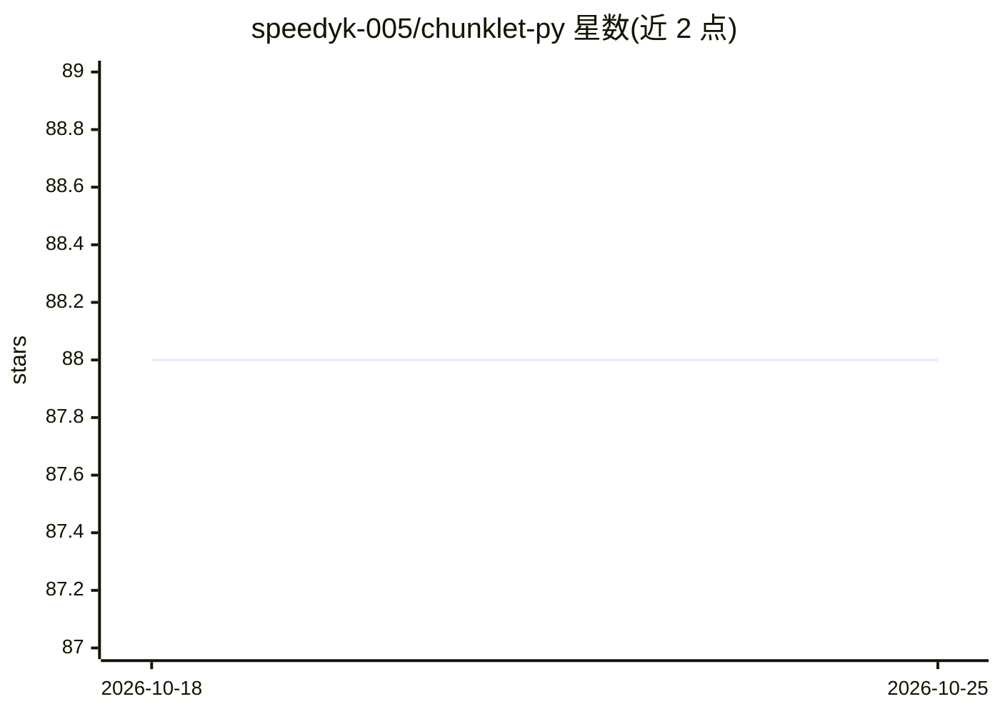

# speedyk-005/chunklet-py

⭐ 88 · Python · MIT · 推送 2026-10-24 · [GitHub](https://github.com/speedyk-005/chunklet-py) · [官网](https://speedyk-005.github.io/chunklet-py/latest) · 个人维护

**面向 RAG/LLM 的文本、代码与文档智能分块 Python 库**

为开发者、研究者与 AI 工程师提供的文本分块库：提供 SentenceSplitter、DocumentChunker、CodeChunker、SelfTuningChunker 与网页版 ChunkVisualizer 五个工具。采用约束式配置（句子/词元/行/函数等限制可组合），支持 60+ 语言自动检测，处理 PDF、DOCX、EPUB、Markdown、HTML、LaTeX 等 15 种格式，每个分块附带来源、span 等元数据。以 pip 安装的库形式提供，另有 CLI 与源码安装方式；可选功能（结构化文档、代码分块、语言检测等）通过 extras 安装。注意 Version 3 存在破坏性变更。

## 筛选速览

| 维度 | 判定 | 备注 |
|---|---|---|
| AI 角色 | `ai-ecosystem` | LLM/agent 周边工具 |
| 许可风险 | `permissive` | MIT |
| 部署形态 | `library` | 以包/库形式分发 |
| 模型依赖 | — | README 未给出锁定关系 |
| 硬件要求 | — | 无带数字的原话,不猜 |
| 安装摩擦 | `low` | 无编译、无系统依赖或容器化 |
| 成熟度 | — | 结构信号不足 |

## 能力要点

- 5 个分块工具：句子切分、文档分块、代码分块、自调优分块、网页可视化
- 约束式配置：句子/词元/行/函数等限制可组合使用
- 支持 60+ 语言自动检测与 15 种文档格式（PDF/DOCX/EPUB/LaTeX 等）
- CLI、Python 库、网页可视化三种使用界面

## 适用场景

- 为 RAG 管道准备文本/代码/文档的分块数据
- 为 LLM 应用预处理长文档并保留结构与元数据
- 交互式调参并可视化检视分块效果

## 场景标签

 · 领域:NLP/RAG 数据处理

## 证据(README 行号)

> L44: **Chunklet-py** is a developer-friendly text splitting library for devs, researchers, and AI engineers. It goes way
> L61: Perfect for prepping data for LLMs, building RAG systems, or powering AI search - Chunklet-py gives you the precisi

## 星数曲线

2026-10-18 88 → 2026-10-25 88（+0）

---
*卡片 v1 · prompt 1.4 · 生成 2026-10-23 · 置信度 high · 依据 README sha `258ea0fe7d3d` · [字段定义](../../DATASET.md)*
