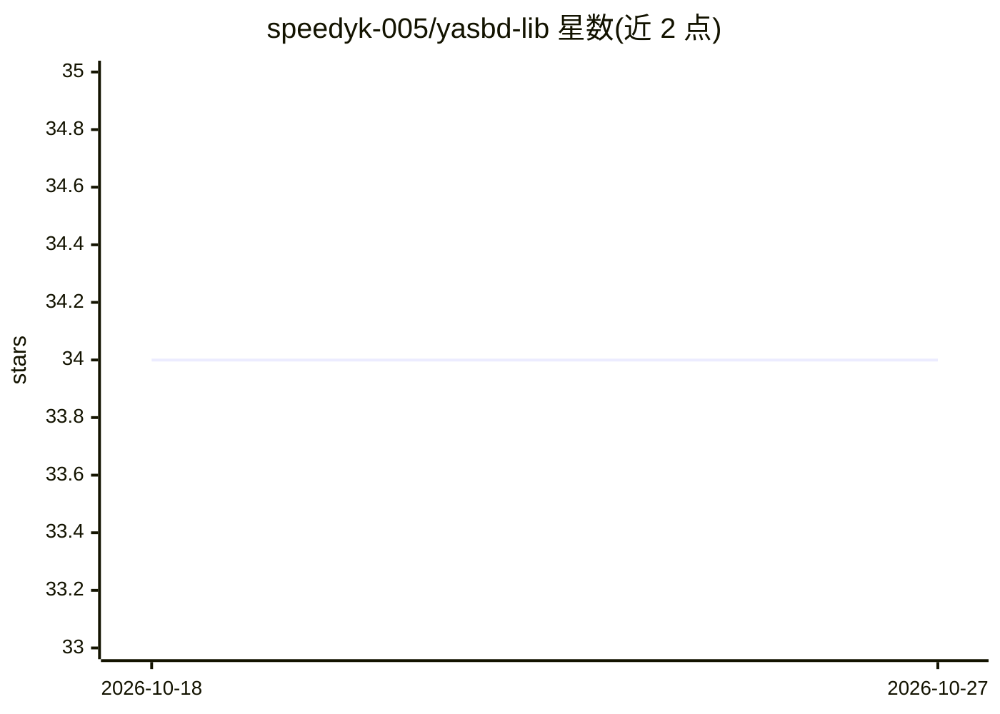

# speedyk-005/yasbd-lib

⭐ 34 · Python · MPL-2.0 · 推送 2026-10-26 · [GitHub](https://github.com/speedyk-005/yasbd-lib) · [官网](https://deepwiki.com/speedyk-005/yasbd-lib) · 个人维护

**面向生产 NLP 管线的多语言规则式句子边界检测库**

纯 Python 的规则式句子边界检测器（SBD），采用两遍流水线：先找出所有候选边界，再用 9 类以上句中模式（缩写表、称号/首字母保护、引号/括号跨度、列表标记等）剔除误报。内置 39 种语言规则（v1.x 已冻结，新语言经 external_lang_packs 外部包加载），提供 detect()/segment() 惰性流式 API、StreamCleaner 文本清理器、pysbd 即插即用适配器与 CLI。源于 chunklet-py 项目，面向 NLP/RAG 管线开发者。

## 筛选速览

| 维度 | 判定 | 备注 |
|---|---|---|
| AI 角色 | `ai-ecosystem` | LLM/agent 周边工具 |
| 许可风险 | `permissive` | MPL-2.0 |
| 部署形态 | `library` | 以包/库形式分发 |
| 模型依赖 | — | README 未给出锁定关系 |
| 硬件要求 | — | 无带数字的原话,不猜 |
| 安装摩擦 | `low` | 无编译、无系统依赖或容器化 |
| 成熟度 | — | 结构信号不足 |

## 能力要点

- 两遍流水线：候选边界发现 + 9 类句中模式剔除误报
- 内置 39 种语言规则，v1.x 冻结后经 external_lang_packs 扩展
- detect()/segment() 支持流式惰性处理大文档，无需全部载入内存
- StreamCleaner 清理 mojibake/OCR 伪影/HTML 标记后再切分
- 提供 pysbd 即插即用适配器

## 适用场景

- 为分词、NER、情感分析等 NLP 管线做句子切分预处理
- RAG 文档分块前获得干净的句子边界
- 处理 OCR/爬取得到的含噪文本并切句
- 替换现有 pysbd 调用而不大改代码

## 场景标签

 · 领域:NLP/文本处理

## 证据(README 行号)

> L27: **Y**et **A**nother **S**entence **B**oundary **D**etector is a pair of smart scissors for text. Pointer-based, fro
> L70: - **📚 Document Chunking & RAG**: Clean sentence boundaries for vector database ingestion and retrieval-augmented ge

## 星数曲线

2026-10-18 34 → 2026-10-27 34（+0）

---
*卡片 v1 · prompt 1.4 · 生成 2026-10-25 · 置信度 high · 依据 README sha `5b0f17dafb69` · [字段定义](../../DATASET.md)*
