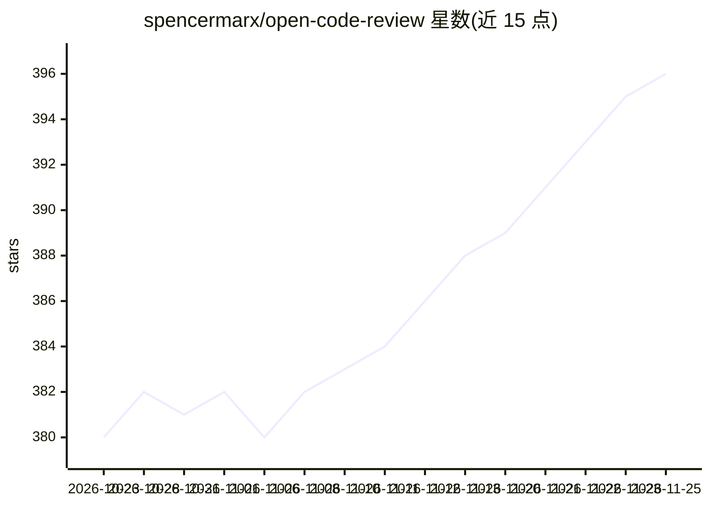

# spencermarx/open-code-review

⭐ 396 · TypeScript · Apache-2.0 · 推送 2026-11-11 · [GitHub](https://github.com/spencermarx/open-code-review) · 个人维护

**给 AI 辅助开发者的多智能体代码审查 CLI 与仪表盘**

一个 npm CLI 加浏览器仪表盘，为 AI 辅助开发流程提供多智能体代码审查：Tech Lead 智能体按 8 阶段流程编排最多 28 种审查者角色独立并行审查代码，审查者之间以 AGREE/CHALLENGE/CONNECT/SURFACE 结构化辩论后合成最终报告。支持按需求文件审查、多轮迭代、20+ 文件变更集的 Code Review Map、GitHub PR 发布与自定义审查者。前提条件为 Node.js ≥22.5、Git 与已安装的 AI 编码助手，需配合 Claude Code 或 OpenCode 运行。

## 筛选速览

| 维度 | 判定 | 备注 |
|---|---|---|
| AI 角色 | `ai-native` | 本体是模型或模型工具 |
| 许可风险 | `permissive` | Apache-2.0 |
| 部署形态 | `library` | 以包/库形式分发 |
| 模型依赖 | — | README 未给出锁定关系 |
| 硬件要求 | — | 无带数字的原话,不猜 |
| 安装摩擦 | `low` | 无编译、无系统依赖或容器化 |
| 成熟度 | — | 结构信号不足 |

## 能力要点

- 8 阶段工作流中多个审查者智能体独立并行审查并聚合发现
- 审查者间结构化辩论（AGREE/CHALLENGE/CONNECT/SURFACE）后再合成报告
- 28 种内置审查者角色，支持持久化自定义与一次性内联审查者
- 不同审查者可配置不同模型，仪表盘自动发现已装厂商可用模型

## 适用场景

- 在合并前用多个 AI 审查者交叉审查大型变更集
- 对照 spec/proposal/验收标准逐条核验代码是否满足需求
- 把团队审查结果以团队口吻或单人自然口吻发布到 GitHub PR
- 为大型重构生成 Code Review Map 并在仪表盘中分节浏览

## 场景标签

`多智能体` `代码审查` · 领域:Agent 开发

## 证据(README 行号)

> L3:  Customizable multi-agent code review for AI-assisted development
> L25: `ocr init` detects your installed AI tools (Claude Code, Cursor, Windsurf, and 11 more) and configures each one aut
> L175: OCR follows an 8-phase workflow orchestrated by a Tech Lead agent:

## 星数曲线

2026-10-23 380 → 2026-11-25 396（+16）

---
*卡片 v1 · prompt 1.4 · 生成 2026-11-25 · 置信度 high · 依据 README sha `e3ff8ceb066c` · [字段定义](../../DATASET.md)*
